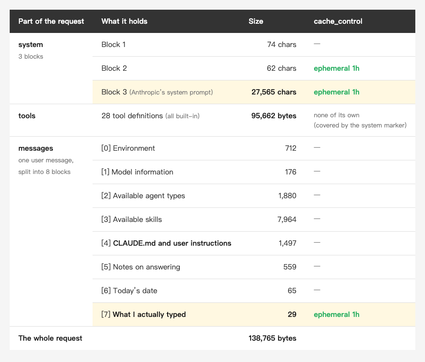
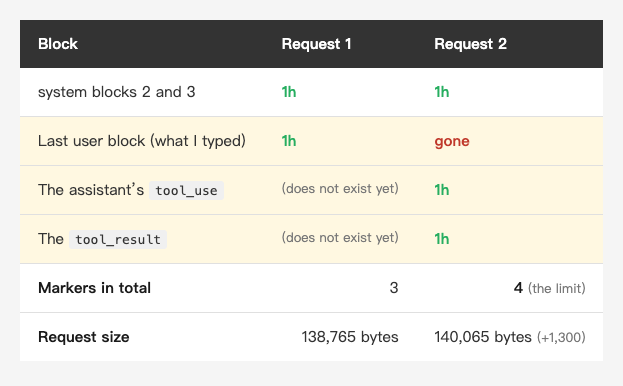
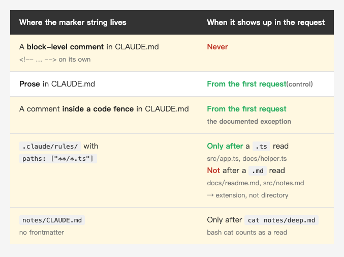

<!-- Tags: Claude Code, AI, Developer Tools, Prompt Engineering, Debugging -->

<!--
Medium custom URL(英文版)— 發布前一定要設,發布後永遠改不了:
    capturing-my-own-claude-code-requests

設定方式:編輯畫面右上 Publish 旁的「…」三點選單
    → More settings → Advanced settings → 勾選 Custom
    → 在欄位貼上上面那串(只填 slug,不含網域與 hex ID,Medium 會自動接 -<12碼hex>)

⚠️ 按下發布後 slug 就定了,改標題也不會更新。唯一補救是刪掉重貼,
   而那會換掉 hex ID,所有既有連結與統計一起消失。
-->

# Capturing My Own Claude Code Requests: What's Inside That 138 KB

How does what I write in CLAUDE.md actually reach the model? You can watch it happen. Point `ANTHROPIC_BASE_URL` at a proxy on your own machine, and **the JSON that goes out is sitting right there**.

The first thing that stopped me had nothing to do with CLAUDE.md. My question was 29 characters long. The request was **138,765 bytes**.

This article takes that package apart: what is in it, which parts you control, and the small piece that only capturing can show you because the docs don't cover it.

---

## 1. How to capture it

I picked up this approach from [Kaochenlong's "側錄 Claude Code!"](https://ithelp.ithome.com.tw/articles/10411515), written in Traditional Chinese, including the rule about describing the shape without quoting the contents.

Claude Code reads the `ANTHROPIC_BASE_URL` environment variable. That is **a supported setting**, meant for self-hosted gateways and corporate proxies, not a workaround. Point it at localhost, put a small program in between that writes each request body to disk and forwards it unchanged, and you have a log of every Messages API request that goes through it.

The whole proxy is 57 lines of standard library. Two parts matter; the rest is HTTP boilerplate.

**Redact the sensitive headers first**, on the line that writes the record, not in a cleanup pass afterwards:

```python
SECRET = {"authorization", "x-api-key", "cookie", "proxy-authorization"}

hdrs = {k: (f"<redacted {len(v)} chars>" if k.lower() in SECRET else v)
        for k, v in self.headers.items()}
rec = {"i": idx, "ts": time.time(), "method": method, "path": self.path,
       "headers": hdrs, "body_bytes": len(body)}
rec["body"] = json.loads(body) if body else None
(OUT / f"{idx:03d}.json").write_text(
    json.dumps(rec, ensure_ascii=False, indent=2), encoding="utf-8")
```

Look at that last line, `rec["body"] = json.loads(body)`. **The redaction covers headers only. The body is stored raw**, every byte of it (see point 2 below).

**Forward the response as you read it.** Claude Code uses SSE. If your proxy reads the whole response before writing anything back, the CLI spins until it times out:

```python
self.send_header("transfer-encoding", "chunked")
self.end_headers()
while True:
    chunk = r.read1(8192)
    if not chunk: break
    self.wfile.write(b"%x\r\n%s\r\n" % (len(chunk), chunk))
    self.wfile.flush()
self.wfile.write(b"0\r\n\r\n")
self.wfile.flush()
```

Do not swap `read1` for `read`. On the `http.client.HTTPResponse` this proxy gets back, `read(8192)` keeps reading until it has 8192 bytes or the connection ends (other stream implementations may differ). I tested it against an SSE endpoint sending one small event every 0.15 seconds: `read` returned exactly once, with everything piled up at the end, while `read1` delivered all 12 events as they arrived. Real responses are large enough that `read` still flushes every 8 KB and never hits a timeout, but that is no longer streaming.

Then start Claude Code like this and use it normally: `ANTHROPIC_BASE_URL=http://127.0.0.1:8787 claude`

**Three things I am not publishing:**

1. **That 27,565-character system block is Anthropic's own content.** I describe only its shape and size, how many blocks, how long, where `cache_control` sits, and **quote none of it**.
2. **In this capture, `metadata` has a single field, `user_id`, and its value is a JSON string holding `device_id`, `account_uuid` and `session_id`.** Those identify my account. The snippet above redacts headers only; `metadata` lives in the body and needs its own pass. Do not go looking for those three field names either, because they are inside the value: you have to redact the whole `user_id`. I got this wrong the first time. The rule has to cover the entire JSON, not just the headers.
3. **Captured logs do not go into any repository.**

If you try this yourself, treat points 2 and 3 as hard rules. A single request is 138 KB holding your CLAUDE.md, your skill list and your question. It describes what you are working on better than you would expect.

The runs came in three batches, with two weeks between the first and the other two:

- **Anatomy of the request and the cache markers** (sections 2 and 3): Claude Code **2.1.294**, `claude-haiku-4-5-20251001`, 2026-10-08
- **The marker-string comparison** (section 4): Claude Code **2.1.306**, `claude-haiku-5-5`, 2026-10-23
- **The control group for `paths:`** (section 4): Claude Code **2.1.309**, `claude-haiku-5-5`, 2026-10-23

Implementation details like these change between versions, and section 4 shows how fast. So every conclusion carries its date and version number.

---

## 2. Taking apart those 138,765 bytes

October 8, a test repo with three files in it, one question 29 characters long.

*(Insert image here: table-anatomy-en.png)*

<!--
| Part of the request | What it holds | Size | cache_control |
|---|---|---|---|
| **system** (3 blocks) | Block 1 | 74 chars | — |
| | Block 2 | 62 chars | ephemeral 1h |
| | Block 3 (Anthropic's system prompt) | **27,565 chars** | ephemeral 1h |
| **tools** | 28 tool definitions (all built-in) | **95,662 bytes** | none of its own (covered by the system marker) |
| **messages** (one user message, split into 8 blocks) | [0] Environment | 712 | — |
| | [1] Model information | 176 | — |
| | [2] Available agent types | 1,880 | — |
| | [3] Available skills | 7,964 | — |
| | [4] **CLAUDE.md and user instructions** | 1,497 | — |
| | [5] Notes on answering | 559 | — |
| | [6] Today's date | 65 | — |
| | [7] **What I actually typed** | **29** | **ephemeral 1h** |
| **The whole request** | | **138,765 bytes** | |
-->

A note on units first, or the numbers won't add up. In that table, the system and messages figures are **character counts**. `tools` has no text field at all, it is JSON schema throughout, so the only thing to measure is its serialized length. And 138,765 at the bottom is **the byte count of the body**. **Three different measurements, so you cannot add them together.** A Chinese character takes 3 bytes, which makes block [4] 2,157 bytes rather than the 1,497 characters shown.

Converted to serialized bytes, the split looks like this:

- **tools: 95,662 bytes, 68.9%**
- system: 28,210 bytes, 20.3%
- messages: 14,287 bytes, 10.3%

Those come to 138,159, which leaves 606 of the 138,765 for `model`, `metadata`, `max_tokens` and the other top-level fields, plus the JSON punctuation itself.

**The largest block is the tool definitions, close to seven tenths of the whole thing.** I had expected Anthropic's system prompt to be the big spender. It comes second, and it is under a third of the size of the tool definitions. The JSON schema for 28 tools, every parameter with its type, description and whether it is required, is the bulk of this package.

All 28 are **built-in tools**; no MCP server was connected. The three largest are `Bash` (12,251 bytes), `DesignSync` (8,996) and `Agent` (8,983). That one `Bash` definition is 5.7 times the size of the "CLAUDE.md and user instructions" block, which is 1,497 characters in the table, or 2,157 bytes. Every MCP server you connect adds its definitions to this same block, **and all of it is sent on every turn**.

**Second largest is the list of skills I installed myself, 7,964 characters**, about 275 times what I typed. That one has nothing to do with Anthropic. I installed those.

One more thing I hadn't expected: **"one user message" is actually 8 blocks.** Environment, model information, available agents, available skills, CLAUDE.md, notes on answering, today's date. Those seven are each wrapped in `<system-reminder>` and packed into **a single user message**, with what I typed in eighth and last place.

---

## 3. Where the cache markers sit

Most of that 138 KB reappears in the request body on every turn. Reappearing is not the same as being recomputed, though: `cache_control` marks which prefix is cacheable. Whether that prefix was written to the cache this time or read from an existing one is not visible in the request. That takes the `usage` figures from the response, and my proxy logs requests only.

*(Insert image here: table-cache-en.png)*

<!--
| Block | Request 1 | Request 2 |
|---|---|---|
| system blocks 2 and 3 | 1h | 1h |
| Last user block (what I typed) | **1h** | **gone** |
| The assistant's `tool_use` | (does not exist yet) | **1h** |
| The `tool_result` | (does not exist yet) | **1h** |
| **Markers in total** | 3 | **4 (the limit)** |
| **Request size** | 138,765 bytes | 140,065 bytes (+1,300) |
-->

Request 1 carries three markers, on the last two system blocks and on what I typed. Request 2 carries four, and four is the ceiling: the API docs cap it at 4 cache breakpoints. So request 2 did not simply gain `tool_use` and `tool_result`. **The marker on what I typed disappeared.** Whether it gave way because the quota was full, or whether the placement is recomputed every turn anyway, two requests can't tell me.

Notice the `tools` row as well. It carries no marker, which does not mean it goes uncached. The docs describe the cached prefix as running from the front through `tools` → `system` → `messages`, up to the marked block. `tools` comes first, so the marker on system block 2 **already covers all 95,662 bytes of it**. It doesn't need one of its own.

One full tool call round trip grows the package from 138,765 to 140,065, **1,300 bytes more**. Almost all of it lands in messages, which goes from 14,287 to 15,469, a net 1,182: the new `thinking`, `tool_use` and `tool_result` blocks take 1,230 bytes in the array, and the `cache_control` dropped from the block holding what I typed gives 48 back. Against a 138 KB fixed base, that is rounding error.

But bytes are not cost. These figures show the ratio between the fixed structure and the per-turn growth; they cannot tell you what it costs. That takes the real token counts against three different rates: input, cache write and cache read.

---

## 4. Which parts of CLAUDE.md get in, and where they land

This is what I wanted to look at in the first place.

I planted five unique marker strings in five places in a test repo, then had it do three things in order: Read `docs/readme.md`, Read `src/app.ts`, and finally `cat notes/deep.md` from bash. Four requests in all, each searched for all five strings. That batch ran on 2.1.306. The `paths:` row also uses a control group from a separate session on **2.1.309**, which comes up below; the other four rows come only from the 2.1.306 batch.

*(Insert image here: table-markers-en.png)*

<!--
| Where the marker string lives | When it shows up in the request |
|---|---|
| A **block-level comment** in CLAUDE.md (`<!-- … -->` on its own) | Never |
| **Prose** in CLAUDE.md | From the first request (control) |
| A comment **inside a code fence** in CLAUDE.md | **From the first request** — the documented exception |
| `.claude/rules/` with `paths: ["**/*.ts"]` | **Only after** a `.ts` read (`src/app.ts`, `docs/helper.ts`); **not** after a `.md` read (`docs/readme.md`, `src/notes.md`) → extension, not directory |
| `notes/CLAUDE.md` (no frontmatter) | Only after `cat notes/deep.md` — bash `cat` counts as a read |
-->

The first three rows are CLAUDE.md itself. They hold up, and the docs state both rules more precisely than my test did:

> Block-level HTML comments (`<!-- maintainer notes -->`) in CLAUDE.md files are stripped before the content is injected into Claude's context. **Comments inside code blocks are preserved.**

> Claude Code loads each one once Claude reads, writes, or edits **another file in that subdirectory**.

What I had missed on the first rule was the word "block-level" and the exception that comes with it: a comment inside a code fence **does** reach the context. That is the third row, present from the first request onward. The second rule is triggered by the **subdirectory**, and Write, Edit or even `cat` on a single file all count, not just Read. The `notes/CLAUDE.md` in the last row has no frontmatter at all; a single `cat` pulled it in.

**`paths:` is a different mechanism, and worth not confusing with the subdirectory one.** It is a field of `.claude/rules/`; writing it in a CLAUDE.md does nothing. To show that it matches on a glob rather than a directory, `docs/readme.md` and `src/app.ts` are not enough as samples. Those two change the directory **and** the extension at once, so the result fits a glob but cannot separate the two variables. I opened another session and added two more files to fill in the 2×2: `src/notes.md` (same directory, different extension) and `docs/helper.ts` (different directory, same extension). The outcome tracks the extension cleanly. A `.md` read inside `src/` doesn't trigger it; a `.ts` read inside `docs/` does. **So it is glob matching, not "you opened a folder".** The frontmatter itself never goes out, incidentally: neither `paths` nor `**/*.ts` appears anywhere in the request.

So what did capturing actually buy? One thing the docs do not cover, and **one that changed on both of the cross-version retests I ran**: where that instruction lands.

On October 8, under 2.1.294, it followed the text of a `tool_result`, wrapped in `<system-reminder>`:

```
1  # deep note
2  MARKER_ONLY_IN_NOTES_7Q4Z
3

<system-reminder>
Contents of <lab>/notes/CLAUDE.md:

Load this only when reading files under notes/: MARKER_IN_SCOPED_CLAUDE_7Q4Z

</system-reminder>
```

Two weeks later, under 2.1.306, it **was no longer inside the `tool_result`**. It had become a message of its own with `role: "system"`, placed after that `tool_result`, with no `<system-reminder>` wrapper:

```json
{
  "role": "system",
  "content": [{
    "type": "text",
    "text": "Contents of <lab>/notes/CLAUDE.md:\n\nLoad this only when reading files under notes/: MARKER_SUBDIR_NO_FRONTMATTER_8X2\n"
  }]
}
```

The role sequence of the whole messages array changed with it: `user, assistant, user` before, `user, system, assistant, user, system, …` after. And the `.claude/rules/` rule used **the same form** on 2.1.306. In that batch, the two mechanisms looked alike.

Then it happened again while I was running the control group. That one ran on **2.1.309**, the same day as the batch above and about five hours later, same `claude -p`, same model, same tool set, and the `.claude/rules/` rule was **back inside `role: "user"` wrapped in `<system-reminder>`**, the 2.1.294 form. (That session never read `notes/deep.md`, so I have nothing on the subdirectory CLAUDE.md under 2.1.309.)

**The docs say when a rule loads. They do not say what it looks like once it is in the request. And that shape moved for both mechanisms inside these 15 days, with `.claude/rules/` moving back the same day.**

To be clear about what that is: two separate lines of two versions each, not one mechanism changing twice in a row. For the subdirectory CLAUDE.md I only have 2.1.294 and 2.1.306; for `.claude/rules/` I only have 2.1.306 and 2.1.309, because the lab on October 8 had no `.claude/rules/` in it yet.

This matters in practice. A rule you put in a subdirectory CLAUDE.md or a path-scoped rule is not a global rule that loads late. It arrives as a note attached to the file read, which puts it close to that read and far from the start of the conversation, so a long session pushes it toward the back of the context. Exactly which block it attaches to is an implementation detail, and "the new version does it this way" is not a safe conclusion either, since the next version may move it back.

---

## 5. Back to last week's gap

[Last week](https://medium.com/@n913239/i-measured-apples-51-lines-of-claude-md-2bae59c2df84) I measured Apple's CLAUDE.md: tool calls on the Architecture question dropped from 14.3 to 1.7, a factor of **8.4**, while cost differed by only **1.83x**. The explanation I gave then was an inference.

First, the caveat: **this capture is not the same setup as those 45 runs.** Last week was 2.1.292, `claude-sonnet-5-5`, and `apple/containerization` with 447 files. This was 2.1.294, haiku, and a three-file test repo. So the absolute numbers above are not what those requests looked like, and I never captured those 45 runs.

What the **structure** offers is a reasonable explanation. The system prompt, the tool definitions and that string of `<system-reminder>` blocks go out every turn; the only difference between last week's three groups was the content of the CLAUDE.md, so their fixed base was the same and far from zero, while one extra tool call adds something on the order of 1,300 bytes. **As long as the variable part roughly tracks the tool call count**, the fixed cost appears in both the numerator and the denominator and pulls the ratio toward 1, which means an 8.4x difference in tool calls was never going to show up proportionally on the bill. That is a plausible explanation rather than a verified cause: these bytes measure a different version, a different model and a different repo.

Settling the 1.83 still means capturing both groups and working from the real token counts for input, cache write and cache read. That is for next time. What this run did establish is **how large the fixed base is** — every request in this capture carried 95,662 bytes of tool definitions and a 27,565-character system prompt.

---

## 6. What capturing is good for

Beyond curiosity, there are four uses.

**Finding out what is eating your context.** The most direct one. 95,662 bytes of tool definitions and 7,964 characters of skill list go out **on every turn**. Capture once, list the size of each block, and you have an actionable list: which MCP server to disconnect, which skills you never use. Not noticing something doesn't mean it isn't there, and capturing confirms it is in every request.

**Checking that a setting actually works.** Whether `paths:` in `.claude/rules/` loads when you think it does, whether `claudeMdExcludes` really keeps someone else's CLAUDE.md out of your monorepo, which block a hook's output lands in, whether your CLAUDE.md edit went out at all. These questions share a property: **what the model says it did or did not see is not evidence.** Searching for the string is.

**Auditing what leaves the machine.** If your company says source code cannot go out, you need to be able to answer what was actually sent: which file contents went into the request, whether `.env` got `cat`-ed in, whether customer data was sitting in an error message someone pasted. `ANTHROPIC_BASE_URL` exists for corporate gateways in the first place, so this is its native use. The flip side is that the capture is itself confidential, so access and retention need to be part of the plan.

**Comparing two configurations.** The 1.83x from the previous section is the ready-made example: nothing was captured at the time, so all I could do was reason about why. Capture first, then compare, and you learn where the difference comes from instead of only that there is one.

---

## 7. What this experiment does not tell you

Plainly:

- **Three batches, three versions.** The numbers in sections 2 and 3 belong only to the October 8 batch (2.1.294). The injection shape moved twice inside those 15 days, once per mechanism, and even the tool count dropped from 28 in the October 8 batch to 12 in both October 23 batches. Other things very likely changed too.
- **How the 8 blocks are split, and what is in them, depends on your setup.** That 7,964-character skill list is what I installed. The tool definitions here are 28 built-in tools; connect an MCP server and the block gets longer.
- **Capturing shows you Messages API requests**, not everything Claude Code does. The fast mode availability check and the WebFetch domain safety check both go straight to `api.anthropic.com` and ignore `ANTHROPIC_BASE_URL`.
- **The 1h cache TTL is what I observed, not a default.** The API default is 5 minutes; 1h requires an explicit `ttl` inside `cache_control`. I was on a Claude subscription and still within plan usage.
- **I did not read the system prompt**, so this article will not tell you how Claude Code is instructed to work, only how long that block is and which cache markers sit on it.
- **The cache boundary observation spans two turns.** How the markers move as a conversation grows, I didn't measure.
- **Injection position was only observed with `Read` and `cat`.** The docs say Write and Edit count too; I didn't test them.
- **Neither loading mechanism was observed across all three versions.** I have the subdirectory CLAUDE.md on 2.1.294 and 2.1.306 only, and `.claude/rules/` on 2.1.306 and 2.1.309 only. So "it moved back" applies to `.claude/rules/` alone, and I never saw what the subdirectory CLAUDE.md looks like on 2.1.309.

---

## Summary

The useful thing about capturing is that it turns "I don't know what's in there" into "I can see 95,662 bytes of tool definitions in every single request".

The biggest takeaway this time was a lesson, though: **what I spent time proving with marker strings was already in the docs, written more precisely than my own test.** The docs also told me about the code fence exception, which I hadn't thought of at all, and that one did hold up when I tested it.

So the order is: **read the docs first, then measure what they do not cover.** That is where capturing is irreplaceable. For a subdirectory instruction, the docs tell you when it loads but not where it lands, and that position moved for both mechanisms inside 15 days, with `.claude/rules/` moving back on the same day.

One number I want to keep: **I typed 29 characters and sent 138,765 bytes.** 95,662 of them were tool definitions, close to seven tenths of the package.

I hadn't turned off a single one of those tools, and the skills were installed and left alone. The first thing capturing gets you is usually a clear look at what you have piled up yourself.

---

## References

- [I Measured Apple's 51 Lines of CLAUDE.md: Tool Calls Dropped From 14.3 to 1.7 — What It Saved Was the Model's Checking](https://medium.com/@n913239/i-measured-apples-51-lines-of-claude-md-2bae59c2df84) — last week's article, where that 1.83 figure comes from
- [Claude Code docs: How Claude remembers your project](https://code.claude.com/docs/en/memory) — HTML comment stripping, when a subdirectory CLAUDE.md loads, and `paths:` in `.claude/rules/`
- [Anthropic docs: Prompt caching](https://docs.anthropic.com/en/docs/build-with-claude/prompt-caching) — the 4-breakpoint limit and the `tools` → `system` → `messages` ordering
- [The Complete Guide to CLAUDE.md: Make Claude Code Truly Understand Your Project](https://medium.com/@n913239/the-complete-guide-to-claude-md-make-claude-code-truly-understand-your-project-d9d026b808f1) — how subdirectory CLAUDE.md files are written
- [Kaochenlong, "Day 02 — 側錄 Claude Code!" (capturing Claude Code's traffic, in Traditional Chinese)](https://ithelp.ithome.com.tw/articles/10411515) — the source of the capture method used here
