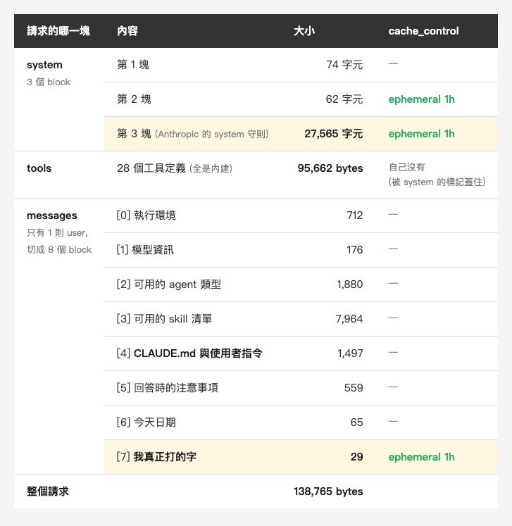
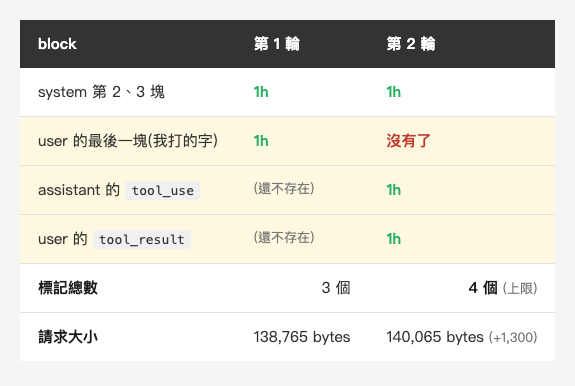
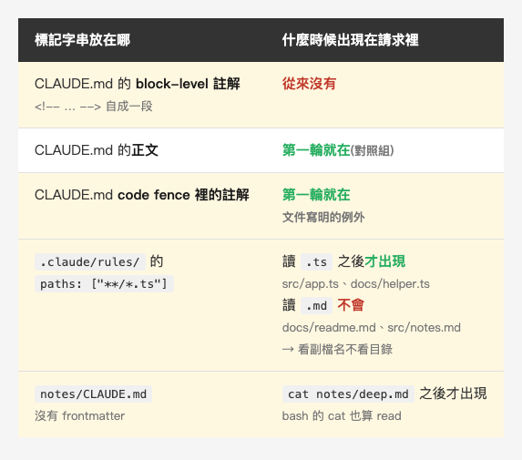

<!-- Tags: Claude Code, AI, Developer Tools, Prompt Engineering, Debugging -->

<!--
Gemini prompt: A cozy Ghibli-style pastel illustration, soft mint/peach/lavender
palette on white background, 16:9. A small friendly robot drops one tiny paper
note into a chute, and out the other side rolls an enormous bundle of paper
many times its size, tied with string. The robot looks up at the bundle,
surprised but not alarmed. Warm, gentle, no text, no letters.
-->

# 側錄自己的 Claude Code 請求:那 138 KB 裡裝了什麼

寫在 CLAUDE.md 裡的東西,到底是怎麼進到模型眼前的?可以這樣觀察:把 `ANTHROPIC_BASE_URL` 指到自己機器上的一個 proxy,**送出去的 JSON 就攤在那裡**。

第一件讓我愣住的事跟 CLAUDE.md 無關:我打了 29 個字元的問題,送出去的請求是 **138,765 bytes**。

這篇就是拆開那包東西:它裝了什麼、哪些是你控制得了的,以及文件沒寫、只有側錄看得到的那一小塊。

---

## 一、怎麼側錄

這個做法我是從[高見龍的〈側錄 Claude Code!〉](https://ithelp.ithome.com.tw/articles/10411515)看到的,包括「只看結構、不貼原文」那條分寸。

Claude Code 認 `ANTHROPIC_BASE_URL` 這個環境變數,那是**官方支援的設定**,給自架 gateway 或企業 proxy 用的,不是什麼破解。把它指到本機,中間放一支會把 request body 落檔、再原樣轉發的小程式,就能記錄經過這支 proxy 的 Messages API 請求。

整支 proxy 57 行,純標準庫。核心只有兩段,其餘是 HTTP 樣板。

**先遮掉敏感 header**,在落檔的那一行就換掉,不是事後再補:

```python
SECRET = {"authorization", "x-api-key", "cookie", "proxy-authorization"}

hdrs = {k: (f"<redacted {len(v)} chars>" if k.lower() in SECRET else v)
        for k, v in self.headers.items()}
rec = {"i": idx, "ts": time.time(), "method": method, "path": self.path,
       "headers": hdrs, "body_bytes": len(body)}
rec["body"] = json.loads(body) if body else None
(OUT / f"{idx:03d}.json").write_text(
    json.dumps(rec, ensure_ascii=False, indent=2), encoding="utf-8")
```

注意最後那行 `rec["body"] = json.loads(body)` —— **遮罩只蓋到 header,body 完全沒有去敏**,原始內容整包留在 log 裡(下面第 2 點)。

**回應一定要邊讀邊轉發**。Claude Code 走 SSE,如果你的 proxy 把回應整個讀完再吐出去,CLI 會一直轉圈等到逾時:

```python
self.send_header("transfer-encoding", "chunked")
self.end_headers()
while True:
    chunk = r.read1(8192)
    if not chunk: break
    self.wfile.write(b"%x\r\n%s\r\n" % (len(chunk), chunk))
    self.wfile.flush()
self.wfile.write(b"0\r\n\r\n")
self.wfile.flush()
```

`read1` 不要換成 `read`:在這支 proxy 拿到的那個 `http.client.HTTPResponse` 上,`read(8192)` 會一路讀到湊滿 8192 bytes 或連線結束才回傳(別種串流實作不一定這樣)。我拿一條每 0.15 秒送一個小事件的 SSE 試過 —— `read` 從頭到尾只回傳一次、全部堆到最後才吐,`read1` 則是 12 個事件各自即時出去。真實回應夠大,`read` 也能每 8 KB 吐一次而不至於逾時,但那已經不是邊讀邊轉發了。

然後這樣起 Claude Code,照常用:`ANTHROPIC_BASE_URL=http://127.0.0.1:8787 claude`

**三件我不會貼出來的東西:**

1. **那個 27,565 字元的 system block 是 Anthropic 的內部內容。** 我只講結構與數字 —— 幾個 block、多長、`cache_control` 壓在哪裡 —— **一個字都不逐字引用**。
2. **這次側錄的 `metadata` 只有一個欄位 `user_id`,但它的值是一包 JSON 字串,裡面裝著 `device_id`、`account_uuid`、`session_id`。** 那是我的帳號識別碼。上面那段只遮 header,`metadata` 在 body 裡,得另外洗 —— 而且別照那三個名字去找欄位,它們在值裡面,遮掉整個 `user_id` 才蓋得住。這是我自己踩到的,落檔的規則要涵蓋整包 JSON,不只是 header。
3. **側錄下來的 log 不進任何 repo。**

如果你要自己跑,第 2、3 點請當成硬規定:一個請求 138 KB,裡面有你的 CLAUDE.md、你的 skill 清單、你問的問題,它比你想的更能描繪你在做什麼。

跑測環境分三批,第一批跟後兩批隔了兩週:

- **請求的解剖與快取標記**(第二、三節):Claude Code **2.1.294**、`claude-haiku-4-5-20251001`、2026-10-08
- **標記字串那組對照**(第四節):Claude Code **2.1.306**、`claude-haiku-5-5`、2026-10-23
- **`paths:` 的控制組**(第四節):Claude Code **2.1.309**、`claude-haiku-5-5`、2026-10-23

這類實作細節隨版本會變 —— 變多快,第四節會講。所以日期與版本號要跟著結論走。

---

## 二、拆開那 138,765 bytes

10 月 8 日那次,在一個只有三個檔的測試 repo 裡,問一句 29 個字元的話。

*(在這裡插入圖片:table-anatomy.png)*

<!--
| 請求的哪一塊 | 內容 | 大小 | cache_control |
|---|---|---|---|
| **system**(3 個 block) | 第 1 塊 | 74 字元 | — |
| | 第 2 塊 | 62 字元 | ephemeral 1h |
| | 第 3 塊(Anthropic 的 system 守則) | **27,565 字元** | ephemeral 1h |
| **tools** | 28 個工具定義(全是內建) | **95,662 bytes** | 自己沒有(被 system 的標記蓋住) |
| **messages**(只有 1 則 user,切成 8 個 block) | [0] 執行環境 | 712 | — |
| | [1] 模型資訊 | 176 | — |
| | [2] 可用的 agent 類型 | 1,880 | — |
| | [3] 可用的 skill 清單 | 7,964 | — |
| | [4] **CLAUDE.md 與使用者指令** | 1,497 | — |
| | [5] 回答時的注意事項 | 559 | — |
| | [6] 今天日期 | 65 | — |
| | [7] **我真正打的字** | **29** | **ephemeral 1h** |
| **整個請求** | | **138,765 bytes** | |
-->

先說單位,不然數字會對不起來。表格裡 system 與 messages 那幾欄是**文字的字元數**;`tools` 沒有文字欄位,它整塊都是 JSON schema,只能量序列化之後的長度;而最下面那個 138,765 是 **body 的位元組數**。**這是三種不同的量法,不能直接相加** —— 中文一個字佔 3 bytes,所以 [4] 那塊 1,497 個字元其實是 2,157 bytes。

全部換成序列化後的 bytes,是這樣分的:

- **tools 95,662 bytes,佔 68.9%**
- system 28,210 bytes,佔 20.3%
- messages 14,287 bytes,佔 10.3%

三者合計 138,159,離 138,765 還差 606,那是 `model`、`metadata`、`max_tokens` 這些頂層欄位,加上 JSON 本身的標點。

**最大的一塊是 tool 定義,佔整包將近七成。** 我原本以為大戶是 Anthropic 那段 system 守則,結果它只排第二,而且不到工具定義的三分之一 —— 28 個工具的 JSON schema,每個參數的型別、描述、必填與否,就是這包東西的主體。

而這 28 個**全是內建工具**,這次沒有掛任何 MCP server。最大的三個是 `Bash`(12,251 bytes)、`DesignSync`(8,996)、`Agent`(8,983) —— 光那一個 `Bash`,就是「CLAUDE.md 與使用者指令」那塊(表上的 1,497 字元 = 2,157 bytes)的 5.7 倍。每接一個 MCP server,它的工具定義會再加進這一塊,**而且每一輪都送**。

**第二大的是我自己裝的 skill 清單,7,964 字元**,是我打的字的約 275 倍。那跟 Anthropic 沒關係,是我自己愈裝愈多的結果。

還有一件事我沒預期:**「一則 user message」其實是 8 個 block。** 執行環境、模型資訊、可用的 agent、可用的 skill 清單、CLAUDE.md、注意事項、今天日期 —— 這七樣全部包成 `<system-reminder>` 塞進**同一則 user message**,我打的字排在第八個、也是最後一個。

---

## 三、快取標記壓在哪裡

138 KB 裡絕大部分每一輪都會重新出現在 request body 裡。但重新出現不等於每次都從頭計算:`cache_control` 標記出哪一段前綴是可以快取的。至於那一段這次是寫進快取、還是命中了既有的快取,請求裡看不出來 —— 那要看回應的 usage,而我的 proxy 只落請求、沒落回應。

*(在這裡插入圖片:table-cache.png)*

<!--
| block | 第 1 輪 | 第 2 輪 |
|---|---|---|
| system 第 2、3 塊 | 1h | 1h |
| user 的最後一塊(我打的字) | **1h** | **沒有了** |
| assistant 的 `tool_use` | (還不存在) | **1h** |
| user 的 `tool_result` | (還不存在) | **1h** |
| **標記總數** | 3 個 | **4 個(上限)** |
| **請求大小** | 138,765 bytes | 140,065 bytes(+1,300) |
-->

第 1 輪三個標記,壓在 system 後兩塊與「我打的字」;第 2 輪變四個,而四個是上限 —— API 文件寫明最多 4 個 cache breakpoint。所以第 2 輪不是單純多長出 `tool_use` 與 `tool_result` 兩個標記,**原本壓在「我打的字」上的那個也消失了**。是因為配額滿了才讓位,還是每輪本來就重新決定標記位置,這次的兩輪資料分不出來。

另外注意表格裡 tools 那列:它自己沒有標記,但不是沒被快取。文件說快取是從頭往後涵蓋 `tools` → `system` → `messages`,到標記那塊為止。`tools` 排在最前面,所以 system 第 2 塊上的標記**已經把那 95,662 bytes 整段蓋進去了** —— 不需要自己帶。

一次完整的 tool call 來回,整包從 138,765 長到 140,065,**多了 1,300 bytes**。那幾乎全在 messages 裡 —— 它從 14,287 長到 15,469,淨增 1,182:新長出來的 `thinking`、`tool_use` 與 `tool_result` 三塊在陣列裡佔 1,230 bytes,而「我打的字」那塊少掉的 `cache_control` 退回來 48。相對於 138 KB 的固定盤,這是零頭。

但 bytes 不是成本。這組數字看得到固定結構與每輪增量的比例,算不出實際花多少錢 —— 那要對照 input token、cache write 與 cache read 三種費率的實際 token 數。

---

## 四、CLAUDE.md 哪幾段進得去,又落在哪裡

這就是我一開始想看的那件事。

我在測試 repo 裡埋了五個獨一無二的標記字串,放在五個不同的地方,然後讓它依序做三件事:先用 Read 讀 `docs/readme.md`,再 Read `src/app.ts`,最後用 bash 的 `cat` 讀 `notes/deep.md`。一共四輪請求,每一輪都搜一次那五個字串。這批跑在 2.1.306。表裡 `paths:` 那列還用到另一組控制組,是在 **2.1.309** 的另一個 session 跑的,下面講 `paths:` 的時候會用到;其餘四列都只來自 2.1.306 那批。

*(在這裡插入圖片:table-markers.png)*

<!--
| 標記字串放在哪 | 什麼時候出現在請求裡 |
|---|---|
| CLAUDE.md 的 **block-level 註解**(`<!-- … -->` 自成一段) | 從來沒有 |
| CLAUDE.md 的**正文** | 第一輪就在(對照組) |
| CLAUDE.md **code fence 裡的註解** | **第一輪就在** —— 文件寫明的例外 |
| `.claude/rules/` 的 `paths: ["**/*.ts"]` | 讀 `.ts` 之後**才出現**(`src/app.ts`、`docs/helper.ts`);讀 `.md` **不會**(`docs/readme.md`、`src/notes.md`)→ 看副檔名不看目錄 |
| `notes/CLAUDE.md`(沒有 frontmatter) | `cat notes/deep.md` 之後才出現 —— bash 的 `cat` 也算 read |
-->

前三列是 CLAUDE.md 本身,結果成立 —— 而且官方文件寫得比我的測試精確:

> Block-level HTML comments (`<!-- maintainer notes -->`) in CLAUDE.md files are stripped before the content is injected into Claude's context. **Comments inside code blocks are preserved.**

> Claude Code loads each one once Claude reads, writes, or edits **another file in that subdirectory**.

我原本漏掉的是第一條的「block-level」和那個例外:註解寫在 code fence 裡面,它**會**進 context(表格第三列,第一輪就在請求裡)。第二條的觸發條件是**子目錄**,而且 Write、Edit、甚至 `cat` 單一檔案都算,不只 Read —— 表格最後一列那個 `notes/CLAUDE.md` 沒有 frontmatter,純粹靠子目錄機制,被一個 `cat` 叫了出來。

**`paths:` 是另一回事,別跟子目錄搞混。** 它是 `.claude/rules/` 的欄位,寫在 CLAUDE.md 上不會有作用。要證明它看的是 glob 而不是目錄,`docs/readme.md` 跟 `src/app.ts` 這兩個樣本不夠 —— 它們同時換了目錄**和**副檔名,結果符合 glob,但分不出是哪個變數在作用。所以我另外開一個 session 補了兩個檔,把 2×2 填滿:`src/notes.md`(同目錄、不同副檔名)與 `docs/helper.ts`(不同目錄、同副檔名)。結果乾淨地跟著副檔名走 —— 在 `src/` 讀 `.md` 不觸發,在 `docs/` 讀 `.ts` 照樣觸發。**所以那是 glob 比對,不是「讀了某個資料夾」。** 順帶一提,frontmatter 本身不會送出去,整包請求搜不到 `paths` 或 `**/*.ts`。

那側錄換來了什麼?一件文件沒寫、而且**我兩次跨版本重測、兩次都變了**的事:那段指令出現在哪裡。

10 月 8 日那次,2.1.294,它接在 `tool_result` 的文字後面,包在 `<system-reminder>` 裡:

```
1  # deep note
2  MARKER_ONLY_IN_NOTES_7Q4Z
3

<system-reminder>
Contents of <lab>/notes/CLAUDE.md:

讀到 notes/ 底下的檔案時才該載入這段:MARKER_IN_SCOPED_CLAUDE_7Q4Z

</system-reminder>
```

兩週後重跑,2.1.306,它**不在 `tool_result` 裡了** —— 自己是一則獨立訊息,`role` 是 `system`,排在那則 `tool_result` 後面,沒有 `<system-reminder>` 包裝:

```json
{
  "role": "system",
  "content": [{
    "type": "text",
    "text": "Contents of <lab>/notes/CLAUDE.md:\n\n讀到 notes/ 底下的檔案時才載入這段:MARKER_SUBDIR_NO_FRONTMATTER_8X2\n"
  }]
}
```

整則 messages 的 role 序列也跟著變:舊版 `user, assistant, user`,新版 `user, system, assistant, user, system, …`。而 `.claude/rules/` 的規則在 2.1.306 用的是**同一個形式** —— 在這一批裡,兩種機制長得一樣了。

然後我補控制組的時候又撞到一次。那組跑在 **2.1.309**,跟上面那批同一天、晚五個多小時,同樣是 `claude -p`、同樣的模型、同樣的工具集 —— `.claude/rules/` 的規則**又回到 `role: "user"` 裡包 `<system-reminder>`**,也就是 2.1.294 的那個形式。(那個 session 沒讀 `notes/deep.md`,所以子目錄 CLAUDE.md 在 2.1.309 長什麼樣,我沒看到。)

**文件只說「什麼時候載入」,沒說「長在哪裡」。而長在哪裡,兩種機制在這 15 天內都動過 —— `.claude/rules/` 那次還是同一天內換回去的。**

但要講清楚:這是兩條各自只有兩個版本的線,不是同一個機制連著換了兩次。子目錄 CLAUDE.md 我只有 2.1.294 跟 2.1.306,`.claude/rules/` 我只有 2.1.306 跟 2.1.309 —— 10 月 8 日那個 lab 根本還沒建 `.claude/rules/`。

這有實際影響:你寫在子目錄 CLAUDE.md 或 path-scoped rule 裡的規則,不是「全域規則延後載入」,而是「讀這個檔的時候順便告訴你」—— 它出現的位置離那次讀檔很近,離對話開頭很遠,對話一長就會被推到 context 後段。至於它確切黏在哪一塊,那是實作細節 —— 而且連「新版改成這樣了」都不能當結論,下一版可能又換回去。

---

## 五、回頭看上週那個落差

[上一篇](https://medium.com/@n913239/%E6%88%91%E9%87%8F%E4%BA%86-apple-%E9%82%A3-51-%E8%A1%8C-claude-md-tool-call-%E5%BE%9E-14-3-%E6%AC%A1%E6%8E%89%E5%88%B0-1-7-%E6%AC%A1-%E7%9C%81%E4%B8%8B%E7%9A%84%E6%98%AF%E6%A8%A1%E5%9E%8B%E7%9A%84%E6%9F%A5%E8%AD%89-91afa7dfbe65)量 Apple 的 CLAUDE.md,Architecture 題的 tool call 從 14.3 次降到 1.7 次,**8.4 倍**;但成本只差 **1.83 倍**。我當時給的解釋是推論。

先講清楚:**這次側錄跟上週那 45 次不是同一組環境** —— 上週是 2.1.292、`claude-sonnet-5-5`、447 個檔的 `apple/containerization`,這次是 2.1.294、haiku、三個檔的測試 repo。所以上面那些絕對數字不是上週請求的長相,我沒有側錄那 45 次。

但側錄看到的**結構**給了一個合理的解釋:system 守則、tool 定義、那串 `<system-reminder>` 每一輪照送,上一篇那三組實驗唯一的差別只在 CLAUDE.md 的內容,固定盤是同一份、而且遠大於零;多跑一輪 tool call 加上去的只有 1,300 bytes 這個量級。**只要變動的那部分大致隨 tool call 數走**,固定成本就同時出現在分子與分母,把比值往 1 拉 —— 8.4 倍的 tool call 差距,本來就不會等比例出現在帳單上。這是個講得通的解釋,不是已經驗證的原因:這組 bytes 量的是另一個版本、另一個模型、另一個 repo。

要把 1.83 算到底還是得兩組都側錄,拿 input、cache write、cache read 三種 token 數去算,那是下一次的事。這次確定的是:**那個固定盤有多大,我看到了** —— 這次側錄的每一輪,都帶著 95,662 bytes 的工具定義與 27,565 字元的 system 守則。

---

## 六、側錄能拿來做什麼

除了滿足好奇心,這件事有四個用得上的地方。

**查你的 context 被誰吃掉。** 這是最直接的。工具定義 95,662 bytes、skill 清單 7,964 字元,這兩塊**每一輪都送**。側錄一次,把各 block 的大小列出來,你就有一張可行動的清單:哪個 MCP server 該關、哪些 skill 根本沒在用。平常感覺不到,不代表它不存在 —— 側錄能確認它每輪都在請求裡。

**驗證設定真的生效。** `.claude/rules/` 的 `paths:` 有沒有在你以為的時機載入、`claudeMdExcludes` 有沒有真的擋掉 monorepo 裡別人的 CLAUDE.md、hook 的輸出進了哪一塊、改完 CLAUDE.md 有沒有真的送出去。這類問題的共同點是:**模型說它看到了或沒看到,都不能當證據**,搜字串才能。

**稽核送出去的東西。** 公司規定原始碼不能外流的話,你需要能回答「到底送了什麼」:哪些檔案內容進了請求、`.env` 有沒有被 `cat` 進去、客戶資料有沒有混在貼上的錯誤訊息裡。`ANTHROPIC_BASE_URL` 本來就是為企業 gateway 設計的,這才是它的原生用途。反過來說,側錄下來的東西本身就是機密,存取權限跟保存期限要一起想。

**比較兩組設定。** 上一節那個 1.83 倍就是現成的例子:當時沒側錄,所以只能推論為什麼。先側錄再比較,你才知道差異來自哪裡,而不是只知道有差異。

---

## 七、這個實驗沒告訴你的事

照實列:

- **三批實驗、三個版本。** 第二、三節的數字只屬於 10/08 那批(2.1.294)—— 注入方式在這 15 天內動過兩次(兩種機制各一次),連工具定義的數量都從 10/08 那批的 28 個掉到 10/23 兩批的 12 個,其他東西很可能也動過。
- **8 個 block 的切法與內容會隨你的環境變。** 那個 7,964 字元的 skill 清單是我自己裝的;工具定義這次是 28 個內建工具,你接了 MCP server 就會更長。
- **側錄看得到的是 Messages API 的請求**,不是 Claude Code 做的每一件事。fast mode 的可用性檢查、WebFetch 的網域安全檢查都直連 `api.anthropic.com`,不跟隨 `ANTHROPIC_BASE_URL`。
- **1h 的快取 TTL 是這次觀察到的值,不是預設值。** API 的預設 TTL 是 5 分鐘,要 1h 得在 `cache_control` 裡明寫 `ttl`。我這次是 Claude 訂閱、還在方案用量內的環境。
- **我沒有看 system 守則寫了什麼**,所以這篇不會告訴你 Claude Code 怎麼被指示去工作 —— 只告訴你那段有多長、壓了什麼快取標記。
- **快取邊界的觀察只跨了兩輪。** 對話變長之後標記怎麼移動,我沒有量。
- **注入位置只在 `Read` 與 `cat` 上看過。** 文件說 Write 與 Edit 也算,但我沒測。
- **沒有任何一種載入機制跨完三個版本。** 子目錄 CLAUDE.md 只有 2.1.294 與 2.1.306 的資料,`.claude/rules/` 只有 2.1.306 與 2.1.309 的 —— 所以「換回去了」只對 `.claude/rules/` 成立,子目錄 CLAUDE.md 在 2.1.309 長什麼樣我沒看到。

---

## 總結

側錄最實用的地方,是它把「我不知道裡面有什麼」變成「我看到 95,662 bytes 的 tool 定義每輪都在那裡」。

但這次最大的收穫其實是個教訓:**我花時間埋標記字串證明的事,查三分鐘文件就有,而且寫得比我的實測精確。** 文件還順便告訴我「code fence 裡的註解會保留」這個我根本沒想到的例外,而那一條實測下來確實如此。

所以這件事的順序是:**先查文件,再量文件沒說的。** 文件沒說的那部分,側錄才有不可取代的價值。像那段子目錄的指令,文件告訴你它什麼時候載入,但不會告訴你它長在哪裡 —— 而那個位置,兩種機制在 15 天內都動過,其中 `.claude/rules/` 還在同一天裡換了回去。

最後一個數字我想留著:**我打了 29 個字元,送出 138,765 bytes。** 其中 95,662 bytes 是工具定義,佔了將近七成。

那些工具我一個都沒關掉,skill 也是裝了就放著。側錄的第一個收穫,常常是看清楚自己堆了什麼。

---

## 參考資料

- [我量了 Apple 那 51 行 CLAUDE.md:tool call 從 14.3 次掉到 1.7 次,省下的是模型的查證](https://medium.com/@n913239/%E6%88%91%E9%87%8F%E4%BA%86-apple-%E9%82%A3-51-%E8%A1%8C-claude-md-tool-call-%E5%BE%9E-14-3-%E6%AC%A1%E6%8E%89%E5%88%B0-1-7-%E6%AC%A1-%E7%9C%81%E4%B8%8B%E7%9A%84%E6%98%AF%E6%A8%A1%E5%9E%8B%E7%9A%84%E6%9F%A5%E8%AD%89-91afa7dfbe65) —— 上一篇,那個 1.83 倍的落差就是從這裡來的
- [Claude Code 官方文件:How Claude remembers your project](https://code.claude.com/docs/en/memory) —— HTML 註解剝除、子目錄 CLAUDE.md 載入時機、`.claude/rules/` 的 `paths:` 都在這裡
- [Anthropic 官方文件:Prompt caching](https://docs.anthropic.com/en/docs/build-with-claude/prompt-caching) —— 4 個 cache breakpoint 的上限、`tools` → `system` → `messages` 的涵蓋順序
- [CLAUDE.md 完全攻略:讓 Claude Code 真正理解你的專案](https://medium.com/@n913239/claude-md-%E5%AE%8C%E5%85%A8%E6%94%BB%E7%95%A5-%E8%AE%93-claude-code-%E7%9C%9F%E6%AD%A3%E7%90%86%E8%A7%A3%E4%BD%A0%E7%9A%84%E5%B0%88%E6%A1%88-3a9478865a11) —— 子目錄 CLAUDE.md 的寫法在這篇
- [高見龍〈側錄 Claude Code!〉](https://ithelp.ithome.com.tw/articles/10411515) —— 本文側錄做法的出處
