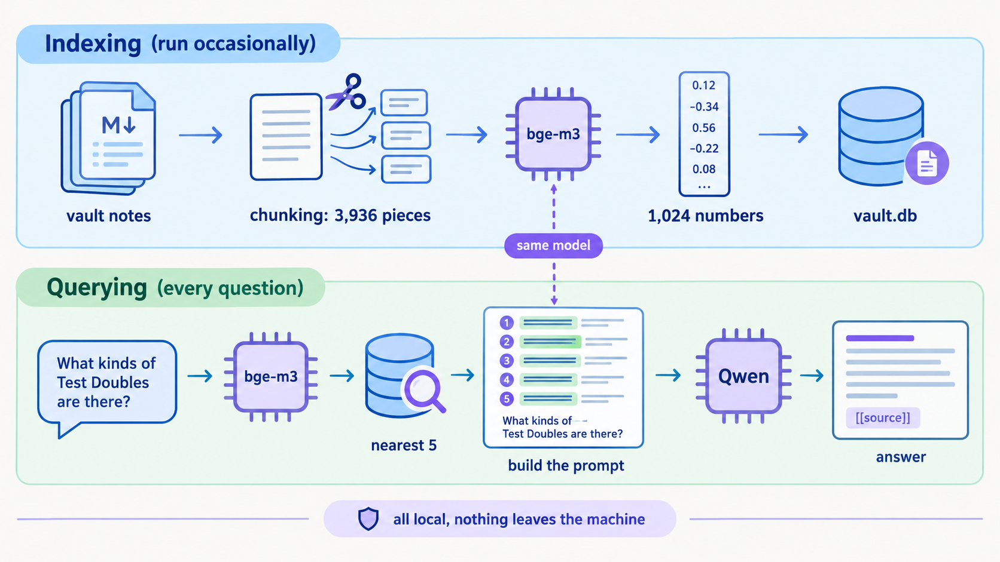
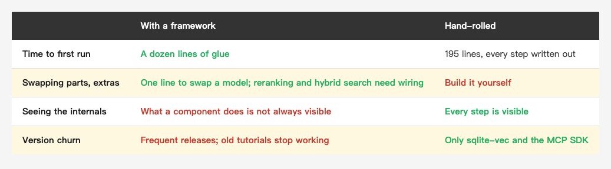
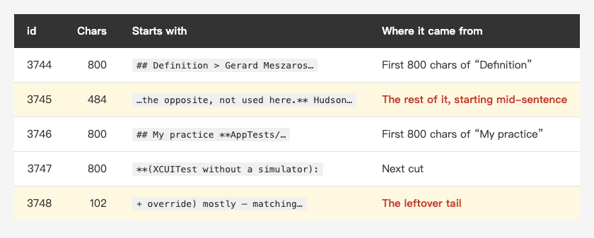
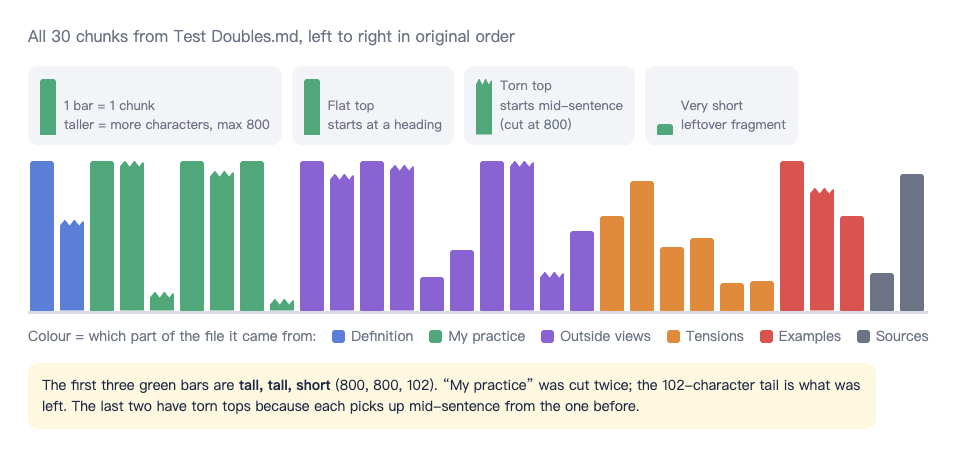
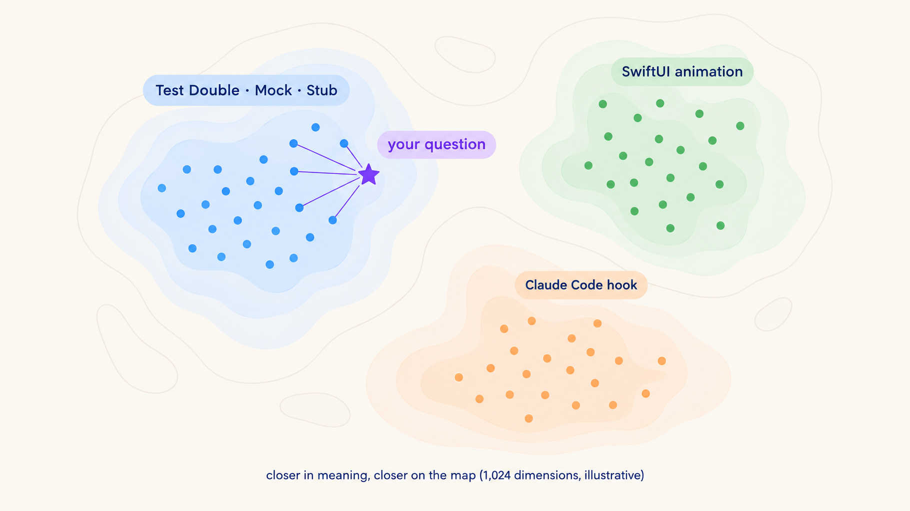
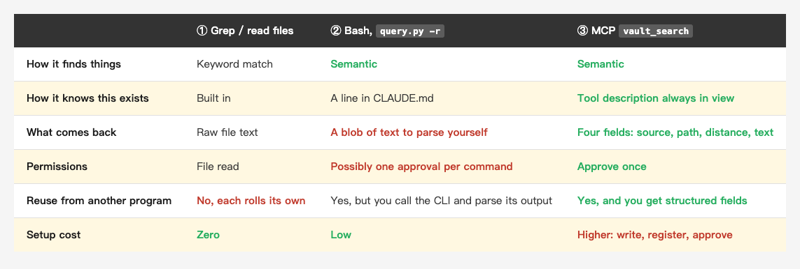
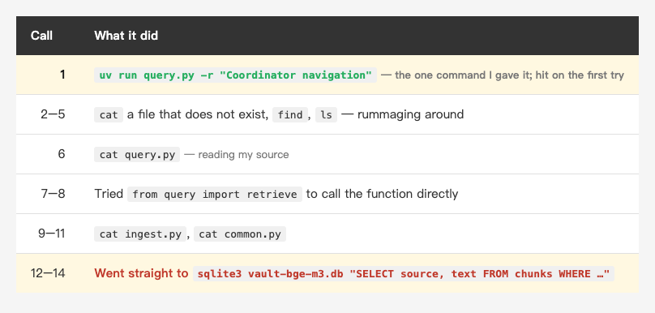
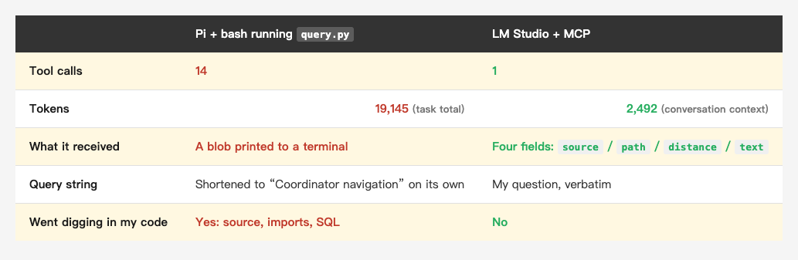

<!-- Tags: RAG, AI, Claude Code, Developer Tools, Python -->

<!--
Medium custom URL(英文版)— 發布前一定要設,發布後永遠改不了:
    i-cut-308-notes-into-3936-cards-a-hand-rolled-offline-rag

設定方式:編輯畫面右上 Publish 旁的「…」三點選單
    → More settings → Advanced settings → 勾選 Custom
    → 在欄位貼上上面那串(只填 slug,不含網域與 hex ID,Medium 會自動接 -<12碼hex>)

⚠️ 按下發布後 slug 就定了,改標題也不會更新。唯一補救是刪掉重貼,
   而那會換掉 hex ID,所有既有連結與統計一起消失。
-->

# I Cut 308 Notes Into 3,936 Cards: 195 Lines of Hand-Rolled Offline RAG, Then Let a Local Model Query It

My knowledge base has 308 compiled notes in it: summaries and concept entries, written over three years.

Claude can't see any of them. Its knowledge stops at its training data, and my notes aren't in there. To get it to cite something I wrote, I first have to remember what the note was called, then paste the path.

This week I fixed that: three Python files, **195 lines**, turning 308 notes into 3,936 index cards. Embedding and generation both run on my own machine, and the index is a single 18 MB SQLite file. No LangChain, no LlamaIndex.

This post walks through all five steps: what each one does, where it bites, and how I eventually wired it into both Claude Code and a model running entirely on my own machine.

---

## 1. The model isn't weak — it just never read my notes

The obvious fix is to paste the notes in. That works for one or two. For 308 notes (3,936 chunks), three things go wrong:

1. **It doesn't fit.** There's a ceiling on how much a model can read at once.
2. **It's slow and expensive.** More text means slower answers, and a cloud API bills by the token.
3. **The signal drowns.** Hand it hundreds of notes and the two relevant paragraphs disappear into the pile.

RAG (Retrieval-Augmented Generation) says: **don't give it everything, give it the relevant part. Find first, then answer.** Three words, three jobs:

- **Retrieval**: pick the 5 closest chunks out of 3,936
- **Augmented**: paste those 5 ahead of the question
- **Generation**: the model answers from those 5 and cites its sources

The useful analogy is an open-book exam. The model is the student, my notes are the textbook, and RAG is the part where someone flips to the right pages before the exam starts. It doesn't have to memorize the book — it just has to read what's open in front of it.

The pipeline splits into two phases: **indexing**, which runs occasionally, and **querying**, which runs every time you ask something.

*(Insert image here: rag-flow-en.png)*

<!--
Gemini prompt (English labels; Chinese version of this image lives in rag-flow.png):
A clean flat vector infographic explaining a RAG pipeline, technical diagram style,
off-white background, generous whitespace, rounded arrows, consistent line icons,
no 3D, no heavy gradients, legible English labels.
Two horizontal swimlanes.
Top lane, soft blue, titled "Indexing (run occasionally)":
a stack of markdown note files labeled "vault notes"
→ scissors cutting a page into small cards, labeled "chunking: 3,936 pieces"
→ a chip icon labeled "bge-m3", turning a text card into a vertical column of numbers, labeled "1,024 numbers"
→ a database cylinder labeled "vault.db".
Bottom lane, soft green, titled "Querying (every question)":
a speech bubble "What kinds of Test Doubles are there?"
→ the same chip icon "bge-m3"
→ a magnifying glass over the database cylinder, labeled "nearest 5"
→ a sheet with five highlighted snippets plus the question, labeled "build the prompt"
→ a larger chip icon labeled "Qwen"
→ an answer card with small tags "[[source]]".
A dashed vertical line connects the two "bge-m3" chips, with a small note "same model".
A thin footer banner: "all local, nothing leaves the machine".
Palette: navy text, soft blue and soft green lanes, purple accents.
Negative: blurry, garbled text, extra labels, photorealistic, 3D render, cluttered, watermark, people, hands
-->

### Why not LangChain

LangChain and LlamaIndex ship every step as a ready-made part: Document Loader, Text Splitter (including one that splits on Markdown headings), Embeddings, Vector Store with a Retriever, and a Chain to join retrieval to generation. Those map onto my `ingest.py`, `common.py` and `query.py`.

*(Insert image here: table-framework-en.png)*

<!--
| | With a framework | Hand-rolled |
|---|---|---|
| Time to first run | A dozen lines of glue | 195 lines, every step written out |
| Swapping parts, extras | One line to swap a model; reranking and hybrid search need wiring | Build it yourself |
| Seeing the internals | What a component does is not always visible | Every step is visible |
| Version churn | Frequent releases; old tutorials stop working | Only sqlite-vec and the MCP SDK |
-->

My reason: the whole point this time was to understand each step. The three things I learned below — cards getting cut mid-sentence, two tables joined by a number, which models need a prefix and which don't — I would not have seen behind a dozen lines of glue.

If the goal is to have something working today, a framework is the right call. If you don't want to write code at all, an Obsidian semantic-search plugin like Smart Connections installs in a minute.

---

## 2. Chunking: a 17,297-character note becomes 30 cards

Relevance is matched per **chunk**, not per file. A single summary might cover five topics; match against the whole file and the one relevant paragraph gets diluted by the other four. So the first step is to cut.

`ingest.py` has three rules:

1. Strip the frontmatter (the YAML between `---` at the top)
2. Split on `#`, `##`, `###` headings. My summaries are already divided into sections like "Conclusion" and "Evidence"
3. Hard-cut anything over 800 characters; drop fragments under 30

One note first. **My vault is written in Chinese**, so every card preview in this post has been translated; the originals, and the questions I ask them, are Chinese. That matters later, because the first embedding model I tried could not read them.

Here's `wiki/concepts/Test Doubles.md`, 17,297 characters, cut into 30 cards (ids 3744–3773):

*(Insert image here: table-chunk-en.png)*

<!--
| id | Chars | Starts with | Where it came from |
|---|---|---|---|
| 3744 | 800 | `## Definition > Gerard Meszaros…` | First 800 chars of "Definition" |
| 3745 | 484 | `…the opposite, not used here.** Hudson…` | The rest of it, starting mid-sentence |
| 3746 | 800 | `## My practice **AppTests/…` | First 800 chars of "My practice" |
| 3747 | 800 | `**(XCUITest without a simulator):` | Next cut |
| 3748 | 102 | ` + override) mostly — matching…` | The leftover tail |
-->

Laid out side by side, all 30 look like this:

*(Insert image here: chunk-shelf-en.png)*


Height is the character count. The flat-topped bars start at a heading, the torn-topped ones pick up mid-sentence from the bar before, and the very short ones are leftover fragments. Four weaknesses follow, and two of them are visible right here.

**The text on each card is verbatim.** RAG does no summarizing or rewriting. It reads like it was tidied up because the source, my compiled summary layer, already was.

This method has four weaknesses. I treat them as a to-do list rather than bugs:

1. **Sentences and code get cut.** Card 3745 opens with "the opposite, not used here", so you can't see what's being contrasted. Another card starts with `lass MovieTests`, because the `c` of `class` went to the previous card.
2. **The parent heading disappears.** When `## External views` is followed immediately by a `###`, that line stands alone, falls under 30 characters, and gets dropped — so the card beneath it doesn't know it belongs to "External views".
3. **Fragments.** A 102-character tail carries almost no information but can still be retrieved, taking one of the five slots.
4. **Frontmatter is lost.** `related:` and `tags:` never make it into the index.

> When a card gets retrieved, it has to stand on its own 800 characters. It can't see anything around it. How you cut decides what you can find.

The usual fixes are overlapping consecutive cards, cutting on sentence boundaries, and prefixing every card with its filename and parent headings ("Test Doubles > External views > …"). I haven't done any of them yet.

That bar chart has a [clickable version](https://n913239.github.io/Medium/2026-10-30-chunks-en/) where every bar opens the card it stands for, and which also draws how the `vec` and `chunks` tables are joined by an id.

I didn't hand-write that page. It came out of Claude Code's `/eli5`, a ten-line skill whose entire content is "explain this to someone who knows nothing about it: big pictures, few words", plus one rule: "write it as a standalone `<!doctype html>` file that opens offline by double-click". The topic I handed it was the `chunks` table; it decided what to draw. For things I understand but can't explain cleanly, letting it draw one is often faster than writing three paragraphs.

---

## 3. Embedding: turning text into 1,024 numbers

This is the step that matters most and makes the least intuitive sense.

**An embedding model turns a piece of text into a list of decimals.** The model I use now, `bge-m3`, produces 1,024 of them:

```
"A Test Double stands in for a real object in tests" → [0.021, -0.113, 0.087, … 1,024 total]
```

The numbers themselves don't matter. What matters is that **text with similar meaning gets similar numbers**. Picture a 1,024-dimensional map: "Test Double", "Mock" and "Stub" land in one region, "SwiftUI animation" in another, "Claude Code hook" somewhere else again.

*(Insert image here: embedding-map-en.png)*

<!--
Gemini prompt (English labels; Chinese version lives in embedding-map.png):
A clean flat vector illustration of a semantic map, like a soft topographic map seen from above,
off-white background, navy text, soft pastel regions, purple accents, no 3D, legible English labels.
Three soft colored clusters of small dots, each with a short label:
a blue cluster labeled "Test Double · Mock · Stub",
a green cluster labeled "SwiftUI animation",
an orange cluster labeled "Claude Code hook".
A bright purple star labeled "your question" placed close to the blue cluster,
with five thin lines connecting it to the five nearest dots.
Caption at the bottom: "closer in meaning, closer on the map (1,024 dimensions, illustrative)".
Minimal text, no axes, no numbers on the map.
Negative: blurry, garbled text, photorealistic, 3D, cluttered, watermark, chart axes, numbers
-->

So "find relevant text" becomes "find the nearest points on a map", which computers are very good at. That's the difference from keyword search: keywords match characters, embeddings match meaning. Ask about "fake objects" and you can still land on a paragraph that says "Test Double".

Three points I only understood by writing it out.

**First, the number of slots and the values in them are different things.** Think of a vector as a scorecard:

- **1,024 (how many slots)**: fixed by the model's design, identical for everyone
- **0.021, -0.113, … (the value in each slot)**: computed from the text, different for every card

Every card and every question gets the same number of slots regardless of length: an 800-character card and a 63-character card both produce 1,024 numbers. And **each slot means the same hidden thing across every card**, which is what makes them comparable at all. Those hidden things are learned during training; they have no names, and one slot on its own means nothing.

The practical consequence: the vector table's column width has to match the model's dimension, or the insert fails outright. So `common.py` records a `dim` per model. **Each model getting its own database file** is my own isolation choice, though — one SQLite file can hold several vector tables.

**Second, both phases must use the same model.** Index with model A and query with model B and the numbers simply don't line up.

**Third, some models require a prefix.** `nomic-embed-text` wants `search_document: ` on stored text and `search_query: ` on questions so it knows which side it's on; `bge-m3` doesn't. This lives in each model's documentation, and skipping it throws no error — it just quietly makes retrieval worse, which is the hardest kind of mistake to notice.

Another trap: every embedding model has a maximum input length, and **going past it does not necessarily raise an error — the overflow may just get dropped silently**. The two GGUF files I run record a trained length of 2,048 tokens for `nomic` and 8,192 for `bge-m3`, and `lms ps` reports those same two numbers as the loaded CONTEXT (LM Studio lets you override it at load time; I didn't). An 800-character card is fine for both, but if I ever make cards bigger I'll need to check. (A different build of the same model can say something else — the PyTorch `nomic` is listed at 8,192.)

> One aside: I started with `nomic-embed-text` and switched to `bge-m3` later. Not for speed — **it couldn't read my Chinese.** Questions written entirely in Chinese failed almost every time. How big that gap was and how I measured it is the next post.

---

## 4. Index and retrieval: one SQLite file, two tables joined by a number

A vector database stores those numbers and answers "which 5 points are nearest to this one" quickly. That operation is **KNN** (k-nearest neighbors).

I use **sqlite-vec**: a SQLite extension, so the whole database is one file (`vault-bge-m3.db`, 18 MB) with no server to run. Chroma, Qdrant and pgvector are all fine, but at this scale (3,936 chunks), on one machine that only I use, I haven't needed any of them.

There are two tables:

- `chunks` holds the text and its origin: `id`, `source`, `text`
- `vec` holds the 1,024 numbers

**They're joined by the same `id`**: the numbers for card 3744 live in row 3744 of `vec`. Retrieval is exactly that join:

```sql
with knn as (
  select rowid, distance from vec where embedding match ? and k = ?
)
select c.source, c.text, knn.distance
from knn join chunks c on c.id = knn.rowid
order by knn.distance
```

The first half is sqlite-vec syntax: find the k nearest vectors. The second half joins back to `chunks` for the text and the filename. This SQL exists in exactly one place, `search()` in `common.py`; the query script, the evaluation script and the MCP tool all call it.

Indexing is the slowest step and it still takes two minutes: **3,936 chunks embedded in batches of 32, about 1 minute 52 seconds with `bge-m3`** (`nomic` takes about 50 seconds; it's far smaller, 84 MB against 635 MB). Rerun it after notes change; the database is a snapshot and doesn't update itself.

### Reading the distances

Every retrieved line starts with a number. This is an actual run:

```
$ uv run query.py -r "how do I safely change old code that has no tests"
── sources retrieved ──
0.815  [[Legacy Refactoring strategy]]  ## Definition **Legacy code = code without tests** (Michael Feathers)…
0.826  [[Sprout Method]]  ### Why not refactor directly — Michael Feathers' dilemma…
0.831  [[20260502 Mentoring group, Legacy Refactoring]]  ## Conclusion **Legacy code = code without tests**…
0.835  [[20260502 No016 Yaroslav Nosik, adding tests to legacy]]  # Conclusion …
0.847  [[20260502 Mentoring group, Legacy Refactoring]]  ### Evidence 1: Legacy Code = Code Without Tests…
```

That number is the **distance between the question and that chunk on the map** (sqlite-vec defaults to L2, straight-line distance). **Smaller is closer**, and 0 means the two vectors are identical.

Two easy misreadings:

1. **You can compare ranks, not thresholds.** 0.815 doesn't mean "very similar"; it only means closer than 0.847. Change the question and the top hit might be 0.5 or 0.7; change the model and the whole range shifts.
2. **Other tools often invert this.** This is a distance, so lower is better. Plenty of RAG tools report a **similarity** instead (cosine similarity, for example), where higher is better and 1 is the maximum. Check which one you're looking at before reading anything into it.

---

## 5. Generation: three rules in the prompt

With 5 chunks in hand, `query.py` builds a prompt and sends it to a local Qwen. The system prompt has three rules:

1. **Answer only from the provided material**
2. **Cite `[[source]]` for every claim**
3. **Say you don't know if the material is insufficient**

`temperature` is 0.2, which makes the output steadier and less random. A low temperature does not make the model stick to the retrieved text, though; keeping it from filling in gaps is a matter of the prompt and of actually testing. One small bit of plumbing: Qwen sometimes emits `<think>…</think>`, which the script strips before printing.

**When RAG gets it wrong, it is nearly always one of two places.** Retrieval failure (the right answer isn't in the 5 chunks) and generation failure (it was there and the answer is still wrong) need completely different fixes — the first means changing the embedding model or the chunking, the second means changing the generation model or the prompt.

That's why `query.py` has an `-r` flag: **retrieve only, don't generate.** Look at `-r` first, then the answer. If retrieval missed, no amount of generation quality will save it. That flag later became the basis for measuring accuracy — next post.

---

## 6. Wiring it in: three ways to let an AI search my notes

At this point the thing works, but I have to run `query.py` in a terminal. To let Claude Code decide for itself when to search, there are three options:

*(Insert image here: table-access-en.png)*

<!--
| | ① Grep / read files | ② Bash, `query.py -r` | ③ MCP `vault_search` |
|---|---|---|---|
| How it finds things | Keyword match | Semantic | Semantic |
| How it knows this exists | Built in | A line in CLAUDE.md | Tool description always in view |
| What comes back | Raw file text | A blob of text to parse yourself | Four fields: source, path, distance, text |
| Permissions | File read | Possibly one approval per command | Approve once |
| Reuse from another program | No, each rolls its own | Yes, but you call the CLI and parse its output | Yes, and you get structured fields |
| Setup cost | Zero | Low | Higher: write, register, approve |
-->

① and ③ complement each other. When I remember the exact term ("Sprout Method"), grep wins. When I only remember the meaning ("how do I safely change old code"), semantic search is what I need. ② already gets most of the benefit — for personal use, one line in CLAUDE.md is enough.

What MCP adds is three things: **initiative** (the tool description sits in the model's view, so it thinks to use it), **structured data**, and **reuse** by other programs — which section 7 depends on.

So I wrote a **separate** `mcp_server.py`, 75 lines on top of those 195, exposing exactly one tool:

```python
vault_search(query, k=5)
# Each hit returns four fields:
#   source    filename   → the model can cite it as [[source]]
#   path      full path  → it can Read the whole note when one chunk isn't enough
#   distance  distance   → tells it which chunk is closest
#   text      verbatim   → what the answer is based on
```

Note that it **only retrieves, never calls Qwen**. Called from Claude Code, Claude itself is the generation step. The G in RAG belongs to the caller.

The three rules from section 5 go with it. They live in `query.py`'s system prompt, and **the MCP path never touches them**. In the two LM Studio runs in the next section, the answers cite no `[[source]]` at all, because there is no system prompt on that side. Wanting the rules means restating them at the caller.

The tool's docstring is what the model actually reads, so it spells out when to use the tool, how to read a distance, and the fact that `text` may start mid-sentence. How well that's written affects whether it thinks to call the tool at the right moment.

### The trap: the error message gets swallowed

When LM Studio isn't running, the tool should come back with "can't reach LM Studio, run `lms server start`" so the model can tell me how to fix it. My first version raised an ordinary `RuntimeError`, and the smoke test reported "an error was returned", which looked right.

Reading the MCP SDK 2.2 source showed what actually happens: **the SDK deliberately keeps ordinary exception messages on the server side** to avoid leaking internals. The model gets a bare "Error executing tool vault_search" and my message is gone. To reach the model it has to be the SDK's own `ToolError`.

The smoke test missed it because it only checked *whether* an error came back, never *what* the error said. It now asserts on the message too.

> Checking that an error occurred isn't enough. Check what the other side sees when it does.

That's my second time hitting this class of problem in the same SDK; the first was [the `FastMCP` rename](https://medium.com/@n913239/building-my-own-mcp-server-237-lines-and-on-its-first-run-it-found-something-i-leaked-three-a50cb522624e).

### Registered per-project, not globally

An MCP server can be registered for one project (a `.mcp.json` in the repo) or for every project. I chose per-project for three reasons: the server is still changing, I want to use it before trusting it, and **privacy** — registered globally, Claude Code might pull my personal notes into a work project without my noticing.

Promoting it to global is one command once I've lived with it for a while, so starting small costs nothing.

> Opening Claude Code in a project with an `.mcp.json` triggers an approval prompt. That's deliberate: cloning someone's repo shouldn't silently run the code their MCP config points at.

---

## 7. If you don't want the data leaving the machine

I've been saying "fully offline", so let me be precise: **indexing and `query.py` are fully local, but once Claude Code calls `vault_search`, the retrieved chunks go into the Claude conversation — which means they go to the cloud.**

That's no different from Claude Code reading the note files directly, so nothing extra is exposed. But if the notes contain things that shouldn't leave the machine, the caller has to change — and this is exactly why the retrieval lives behind an MCP tool rather than a Claude Code hook or skill: **changing the caller doesn't touch the server.**

I tested one such caller: **the Pi coding agent driving a local Qwen, running `query.py` through bash.** Bash rather than MCP isn't laziness — the Pi I ran, 0.84.2, has no MCP client (its built-in tools are read, bash, edit, write, grep, find and ls), so option ② was all it had. (Since then: Pi added built-in MCP in 0.99.0, so this route works now. The numbers below come from when it didn't.)

```bash
pi --provider lmstudio --model qwen3.6-35b-a3b-mlx -t bash --print \
  'Search my notes before answering. Use: cd ~/vault-rag && uv run query.py -r "query"
   — semantic search, prints the 5 closest chunks. Question: how do I safely change
   old code that has no tests? Answer only from what you find, cite the filenames.'
```

The first run looked great: five filenames cited, all of them matching what I'd got from `-r` by hand, and the content was genuinely mine. Every link in the chain — embedding, vector search, generation — **ran as a local service, and none of my notes went to a cloud model**.

Then I asked a different question with full event logging on, and saw what was really happening: **it made 14 bash calls.**

*(Insert image here: table-pi-en.png)*

<!--
| Call | What it did |
|---|---|
| 1 | `uv run query.py -r "Coordinator navigation"` — the one command I gave it; hit on the first try |
| 2–5 | `cat` a file that does not exist, `find`, `ls` — rummaging around |
| 6 | `cat query.py` — reading my source |
| 7–8 | Tried `from query import retrieve` to call the function directly |
| 9–11 | `cat ingest.py`, `cat common.py` |
| 12–14 | Went straight to `sqlite3 vault-bge-m3.db "SELECT source, text FROM chunks WHERE …"` |
-->

Call 1 found the answer — it even shortened my question down to the keywords "Coordinator navigation" on its own. None of the other 13 were anything I asked for. The final answer was correct and properly cited, and the whole question burned 19,145 tokens.

**Why wouldn't it stop?** Look at what it reached for: my `query.py`, then an import, then raw SQL. It wanted a **programmatic interface**, and all I had given it was text printed to a terminal.

That's the gap between ② and ③ in the table above, magnified:

- **② bash** — you get semantic search, but "when to search, and when to stop" has to come from the prompt, and the result is a blob the model has to parse.
- **③ MCP** — the tool description is always in view, and results come back as `source` / `path` / `distance` / `text`. Nothing to parse, no reason to go digging in my database.

I'd assumed MCP's advantage was mostly convenience. Those 14 calls showed me the other half: **give a model an interface that isn't structured enough and it will build its own — in ways you didn't plan for.**

### Same model, over MCP instead

LM Studio is itself an MCP client. One entry under `mcpServers` in `~/.lmstudio/mcp.json` hands **the same `mcp_server.py`** to the local Qwen, and not a character of the server changes. That's the "swap the caller, keep the server" point in practice:

```json
{
  "mcpServers": {
    "vault-rag": {
      "command": "/Users/you/.local/bin/uv",
      "args": ["run", "--quiet", "--project", "/Users/you/vault-rag",
               "python", "/Users/you/vault-rag/mcp_server.py"]
    }
  }
}
```

No host, no port: LM Studio launches the script as a subprocess and talks to it over stdio, the same way Claude Code reads a `.mcp.json`. The `--project` part is what runs it inside `vault-rag`'s own virtualenv — `sqlite-vec` and the rest aren't in the system Python.

My entire prompt was one sentence: "search my notes: how does Coordinator handle navigation". **I taught it no commands at all.** It then:

1. Thought for 1.10 seconds. That reasoning is visible, and two lines of it stand out: "**the tool description suggests asking in natural language**" and "**k defaults to 5**"
2. Asked to call `vault_search` with `{"query": "how does Coordinator handle navigation", "k": 5}` — the whole question as the query string, not compressed into keywords
3. Triggered LM Studio's approval dialog (Proceed / Deny, with an "always allow" checkbox)
4. Got back JSON with four fields, thought for another 3.52 seconds, and answered

*(Insert image here: lmstudio-vault-search.png)*

<!-- LM Studio trial: the local qwen3.6-35b-a3b (MLX) decides on its own to call vault_search with {"query": "how does Coordinator handle navigation", "k": 5}; mcp/vault-rag is toggled on in the right-hand Integrations panel -->

The screenshot is a second run of the same question, which is why its thinking time doesn't match the one above. The middle block is the part to look at: **it decided to call `vault_search` on its own and passed the whole question as `query`**, and `k` never appeared in my prompt at all.

Step 1 is worth pausing on. In section 6 I wrote that the tool's docstring is what the model actually reads, and that how well it's written affects whether it thinks to call it at the right moment. That was a guess. This is the first time I've **watched it happen**: both of those lines are things I wrote in the docstring, read back, used as the basis for a decision, and followed.

*(Insert image here: table-local-en.png)*

<!--
| | Pi + bash running `query.py` | LM Studio + MCP |
|---|---|---|
| Tool calls | 14 | 1 |
| Tokens | 19,145 (task total) | 2,492 (conversation context) |
| What it received | A blob printed to a terminal | Four fields: `source` / `path` / `distance` / `text` |
| Query string | Shortened to "Coordinator navigation" on its own | The whole question |
| Went digging in my code | Yes: source, imports, SQL | No |
-->

**One call and it was done.** No `cat`-ing my source, no poking at the database: the four fields were already the shape it needed. And "when should I search" never had to be stated; this time the tool description carried it.

**This is not a controlled experiment.** The two prompts differ (the Pi one spelled out the command and its usage; the LM Studio one was a single sentence), and the token figures aren't measured the same way (Pi's is the task's cumulative input plus output, LM Studio's is conversation context). The direction is unambiguous, but don't read 14-vs-1 as a precise benchmark.

Three more observations:

- **It's slow.** Qwen 3.6 35B (4-bit MLX) took 15.5 seconds to load 19 GiB, and a question with retrieval and generation runs in minutes, not seconds. Claude Code answers the same question in a dozen seconds or so.
- **A local model shows its seams.** The Pi run slipped a simplified-Chinese character into otherwise traditional text; the LM Studio run was blunter about it — **the entire reasoning trace was in simplified Chinese, and only the final answer switched back to traditional**. It doesn't affect usability, but you can tell this isn't a cloud-class model.
- **It also mis-attributes.** In the run shown in the screenshot, the answer pinned a `navigationController?.pushViewController(…)` snippet to `Sprout Method`, which is Michael Feathers' legacy-refactoring technique and has nothing to do with navigation. That chunk really was among the five retrieved; what went wrong is the model attaching the code to the wrong source. This is the second half of the split from section 5: **retrieval fine, generation wrong.**

---

## Summary

Laid out step by step, none of it is hard:

1. **Chunking** — three rules, the shortest part of the 195 lines, and the one that decides what you can find at all.
2. **Embedding** — text into 1,024 numbers. The slot count is fixed by the model, the values are computed, and both phases must use the same model.
3. **Indexing** — one SQLite file, two tables joined by a number. Under two minutes for 3,936 chunks.
4. **Retrieval** — one SQL statement. Smaller distance is closer; ranks are comparable, thresholds aren't.
5. **Generation** — three rules and `temperature 0.2`, plus an `-r` flag so retrieval can be inspected on its own.

Writing it by hand paid off in a way I didn't expect. The three things only visible with the steps pulled apart — cards cut mid-sentence, two tables joined by a number, which models need a prefix and which don't — all fed into later decisions. Glue a framework together in a dozen lines and I'd still believe it was searching whole notes, rather than one card that might begin in the middle of a sentence.

But this whole post answers only one question: **can it be built.**

Whether it finds the right thing, my answer was "I tried two questions and it seemed fine" — one of which already hinted that English keywords and Chinese questions behaved very differently. That "seemed fine" later scored 40 out of 100 on a 25-question test I wrote myself. The next post is about that test: how to write questions that don't flatter the system, how much the embedding model actually mattered, and what to do when **the test itself turns out to be wrong**.

---

> **On anonymization**: the code, the numbers (308 notes, 3,936 chunks, 17,297 characters, 195 lines, the distance values) are all real. The note examples come from public technical concepts and study-group notes; the test target name in the chunking example was replaced with a generic `AppTests/`. The linked interactive page follows the same rules: the 30 chunk previews on it were put through the same substitutions, and translated from the Chinese originals.

---

## References

- [Building My Own MCP Server — 237 Lines, and on Its First Run It Found Something I Leaked Three Months Ago](https://medium.com/@n913239/building-my-own-mcp-server-237-lines-and-on-its-first-run-it-found-something-i-leaked-three-a50cb522624e) — the previous trap in the same SDK (the `FastMCP` rename), and "the first user of a checker is its own rules"
- [sqlite-vec](https://github.com/asg017/sqlite-vec) — the vector store used here, a SQLite extension
- [BAAI/bge-m3](https://huggingface.co/BAAI/bge-m3) — the multilingual embedding model in use now. It also supports sparse and multi-vector retrieval; this post only uses the dense vectors
- [nomic-embed-text-v1.5](https://huggingface.co/nomic-ai/nomic-embed-text-v1.5) — the model I started with, and the source for the `search_document:` / `search_query:` prefixes
- [LM Studio](https://lmstudio.ai/) — runs the embedding and generation models locally
- [Model Context Protocol](https://modelcontextprotocol.io/) — the MCP specification
- Michael Feathers, *Working Effectively with Legacy Code* — the concept behind the retrieval example
