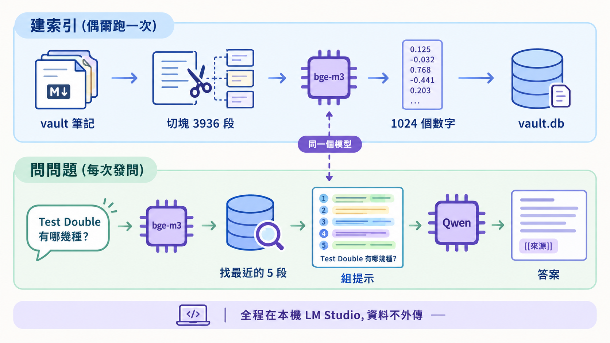
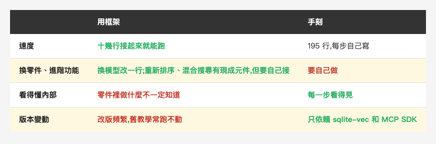
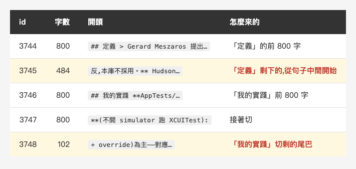
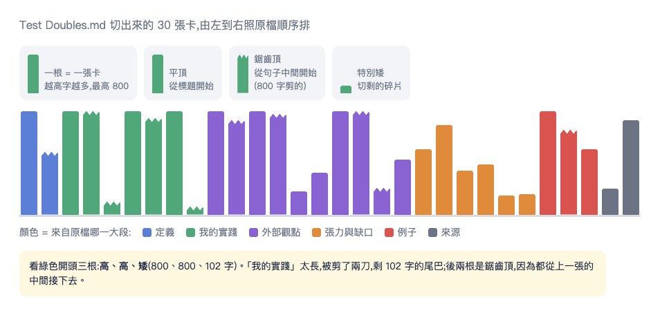
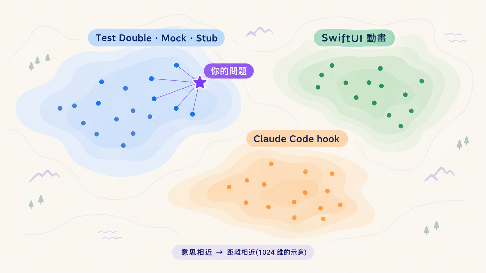
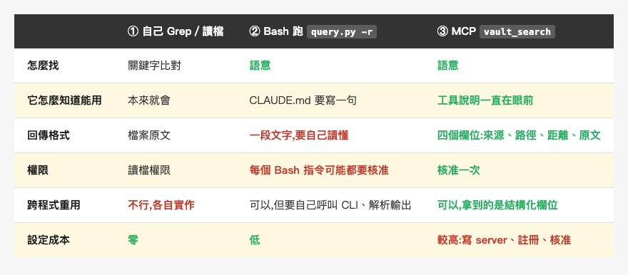
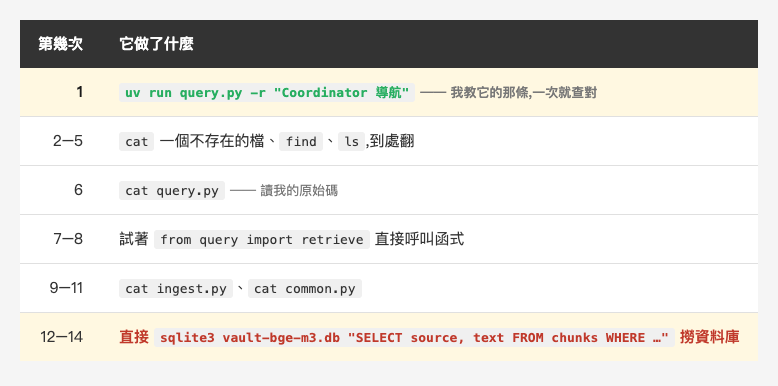
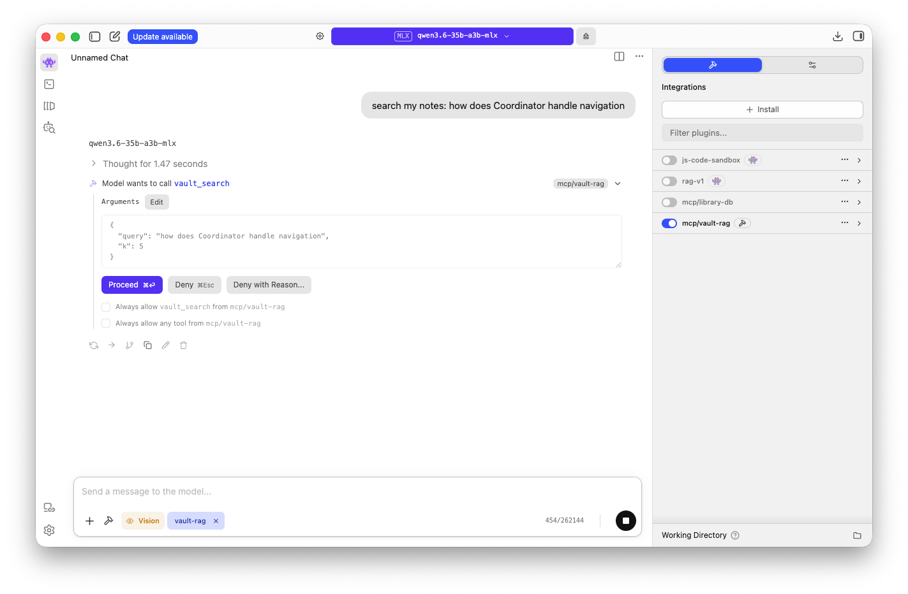
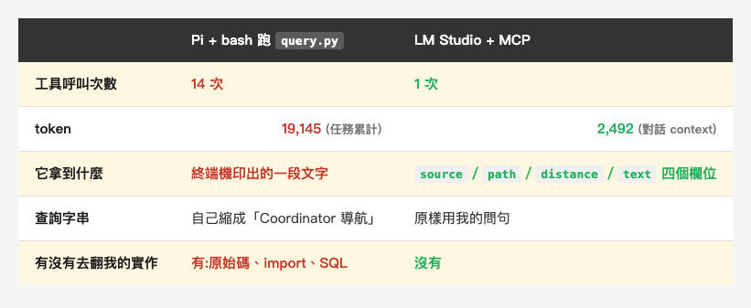

<!-- Tags: RAG, AI, Claude Code, Developer Tools, Python -->

<!--
Gemini prompt: A cozy Ghibli-style pastel illustration, soft mint/peach/lavender
palette on white background, 16:9. A small friendly robot sits cross-legged on
the floor, carefully cutting a tall stack of paper notes into small index cards
with round-tipped scissors. The finished cards are sorted into a neat wooden
card-catalog box beside it, each card with a tiny numbered tab. A warm desk lamp
glows above. Warm, gentle, no text, no letters.
-->

# 我把 308 篇筆記切成 3936 張卡片:195 行手刻一套全離線 RAG,然後讓地端模型自己來查

我的知識庫裡有 308 篇編譯過的筆記 —— 摘要和概念條目,寫了三年多。

但 Claude 看不到它們。它的知識停在訓練資料,我的筆記不在裡面。要它引用我寫過的東西,我得自己先想起來「那篇好像叫什麼」,再把路徑貼給它。

這週我把這件事做掉了:三支 Python 檔、**195 行**,把 308 篇切成 3936 張索引卡,embedding 和回答都在自己機器上跑,索引是一個 18 MB 的 SQLite 檔。沒有用 LangChain,也沒有 LlamaIndex。

這篇把五個步驟逐一攤開 —— 每一步在做什麼、有什麼坑、以及最後怎麼讓 Claude Code 和**完全不連網的地端模型**都能來查。

---

## 一、不是模型不夠強,是它沒讀過我的筆記

最直覺的解法是「把筆記貼給它」。一兩篇可以,308 篇切開來是 3936 段,全部塞進去會遇到三件事:

1. **塞不下** —— 模型一次能讀的長度有上限。
2. **又慢又貴** —— 讀越多字回答越慢,用雲端 API 還按 token 計費。
3. **雜訊太多** —— 一次給它幾百篇,真正相關的那兩段反而被淹沒。

RAG(Retrieval-Augmented Generation,檢索增強生成)的想法很單純:**不要給全部,只給相關的那幾段。先找,再答。** 拆成三個字來看:

- **檢索**:從 3936 段裡挑出最像的 5 段
- **增強**:把那 5 段貼在問題前面
- **生成**:模型根據這 5 段寫回答,並標註來源

比喻是**開書考**:模型是考生,我的筆記是課本。RAG 做的事是考前先幫它把相關的那幾頁翻出來,它不用背整本書,只要讀懂翻到的那幾頁。

整條流程分成兩個階段 —— **建索引**偶爾跑一次,**問問題**每次發問都跑:

*(在這裡插入圖片:rag-flow.png)*

<!--
Gemini prompt(中文標籤;英文版在 rag-flow-en.png,提示詞見 index-en.md):
A clean flat vector infographic explaining a RAG pipeline, technical diagram style,
off-white background, generous whitespace, rounded arrows, consistent line icons,
no 3D, no heavy gradients, legible Traditional Chinese labels.
Two horizontal swimlanes.
Top lane, soft blue, titled "建索引(偶爾跑一次)":
a stack of markdown note files labeled "vault 筆記"
→ scissors cutting a page into small cards, labeled "切塊 3936 段"
→ a chip icon labeled "bge-m3", turning a text card into a vertical column of numbers, labeled "1024 個數字"
→ a database cylinder labeled "vault.db".
Bottom lane, soft green, titled "問問題(每次發問)":
a speech bubble "Test Double 有哪幾種?"
→ the same chip icon "bge-m3"
→ a magnifying glass over the database cylinder, labeled "找最近的 5 段"
→ a sheet with five highlighted snippets plus the question, labeled "組提示"
→ a larger chip icon labeled "Qwen"
→ an answer card with small tags "[[來源]]".
A dashed vertical line connects the two "bge-m3" chips, with a small note "同一個模型".
A thin footer banner: "全程在本機 LM Studio,資料不外傳".
Palette: navy text, soft blue and soft green lanes, purple accents.
Negative: blurry, garbled text, photorealistic, 3D, cluttered, watermark, English labels
-->

### 為什麼不用 LangChain

LangChain 和 LlamaIndex 把 RAG 的每一步都做成現成零件:Document Loader 讀檔、Text Splitter 切塊(有照 Markdown 標題切的)、Embeddings、Vector Store + Retriever、Chain 把檢索串到生成。對應到我手刻的 `ingest.py`、`common.py`、`query.py`。

*(在這裡插入圖片:table-framework.png)*

<!--
| | 用框架 | 手刻 |
|---|---|---|
| 速度 | 十幾行接起來就能跑 | 195 行,每步自己寫 |
| 換零件、進階功能 | 換模型改一行;重新排序、混合搜尋有現成元件,但要自己接 | 要自己做 |
| 看得懂內部 | 零件裡做什麼不一定知道 | 每一步看得見 |
| 版本變動 | 改版頻繁,舊教學常跑不動 | 只依賴 sqlite-vec 和 MCP SDK |
-->

我的理由是:這次的目的就是**搞懂每一步**。下面會寫到的三個發現 —— 卡片被切斷、兩張表靠號碼對接、換模型要確認需不需要前綴 —— 都是因為每一步攤開才看得到。如果十幾行接起來就跑,這些我一個都不會知道。

反過來說,如果目的是「趕快有個東西可以用」,框架是對的選擇;如果連程式都不想寫,Obsidian 的語意搜尋外掛(例如 Smart Connections)裝了就有。

---

## 二、切塊:一篇 17,297 字的筆記變成 30 張卡片

「找相關內容」是以**段**為單位,不是以檔案為單位。一篇摘要可能同時講五件事,整篇拿去比對,相關的那一段會被其他四件事稀釋。所以第一步是切。

`ingest.py` 的切法只有三條規則:

1. 去掉 frontmatter(檔案開頭 `---` 包住的 YAML)
2. 依 `#`、`##`、`###` 標題切開 —— 我的摘要本來就分成「核心結論」「關鍵證據」這種段落
3. 一段超過 800 字就硬切,不到 30 字的碎片丟掉

以 `wiki/concepts/Test Doubles.md` 為例,原檔 17,297 字,切完是 30 張卡(編號 3744–3773):

*(在這裡插入圖片:table-chunk.png)*

<!--
| id | 字數 | 開頭 | 怎麼來的 |
|---|---|---|---|
| 3744 | 800 | `## 定義 > Gerard Meszaros 提出…` | 「定義」的前 800 字 |
| 3745 | 484 | `反,本庫不採用。** Hudson…` | 「定義」剩下的,從句子中間開始 |
| 3746 | 800 | `## 我的實踐 **AppTests/…` | 「我的實踐」前 800 字 |
| 3747 | 800 | `**(不開 simulator 跑 XCUITest):` | 接著切 |
| 3748 | 102 | ` + override)為主——對應…` | 「我的實踐」切剩的尾巴 |
-->

那 30 張排起來是這個樣子:

*(在這裡插入圖片:chunk-shelf.png)*


高度是字數。平頂的那幾根從標題開始切,鋸齒頂的是從上一張的句子中間接下去,特別矮的是切剩的碎片 —— 下面要講的四個弱點,其中兩個在這張圖上直接看得出來。

**卡片上的字是原文照抄**,RAG 沒有做任何摘要或改寫。看起來像「整理過」,是因為來源本來就是我編譯好的摘要層。

這種切法有四個弱點,我把它們當成之後的改進題目而不是 bug:

1. **句子和程式碼會被切斷**:第 3745 張卡從「反,本庫不採用」開始,看不到前面在反什麼;另一張卡的開頭是 `lass MovieTests`,`class` 的 `c` 被切到上一張去了。
2. **上層標題不見了**:「## 外部觀點」底下直接接 `###`,這行單獨成段、不到 30 字被丟掉,結果它下面那張卡不知道自己屬於「外部觀點」。
3. **碎片**:切剩的尾巴(102 字、63 字)資訊很少,卻一樣可能被搜到,占掉 5 個名額之一。
4. **frontmatter 的資訊沒了**:`related:`、`tags:` 這些分類不會進到檢索裡。

> 一張卡片被搜到的時候,它只能靠自己那 800 字跟問題比對,周圍的脈絡完全看不到。切得好不好,直接決定找不找得到。

常見的改法是讓前後卡片**重疊**一點、改在**句號或段落**切、以及每張卡片開頭**補上檔名和上層標題**(「Test Doubles > 外部觀點 > …」)。這些都還沒做。

上面那張長條圖還有一個[可以點的版本](https://n913239.github.io/Medium/2026-10-30-chunks/),每一根都能點開看那張卡實際的開頭,另外也畫了 `vec` 和 `chunks` 兩張表是怎麼靠編號對上的。

那頁不是我手刻的,是用 Claude Code 的 `/eli5` 產的 —— 一個十行的 skill,內容只寫了「把這個題目解釋給完全不懂的人聽:大圖、少字」,外加一條「輸出成自帶 `<!doctype html>` 的單一檔案,離線雙擊可開」。我丟給它的題目就是 `chunks` 這張表,它自己決定要畫哪些圖。這類「我想通了但說不清楚」的東西,交給它畫一遍常常比自己寫三段文字快。

---

## 三、Embedding:把一段文字變成 1024 個數字

這是整條流程最關鍵、也最不直覺的一步。

**Embedding 模型會把一段文字變成一串小數。** 我現在用的 `bge-m3` 吐出 1024 個:

```
「Test Double 是測試用的替身」 → [0.021, -0.113, 0.087, …共 1024 個]
```

重點不是數字本身,而是**意思相近的文字,數字也會相近**。可以想像成一張 1024 維的地圖:「Test Double」「Mock」「Stub」落在同一區,「SwiftUI 動畫」在另一區,「Claude Code hook」又在另一區。

*(在這裡插入圖片:embedding-map.png)*

<!--
Gemini prompt(中文標籤;英文版在 embedding-map-en.png,提示詞見 index-en.md):
A clean flat vector illustration of a semantic map, like a soft topographic map seen from above,
off-white background, navy text, soft pastel regions, purple accents, no 3D,
legible labels (mixed Traditional Chinese and English technical terms).
Three soft colored clusters of small dots, each with a short label:
a blue cluster labeled "Test Double · Mock · Stub",
a green cluster labeled "SwiftUI 動畫",
an orange cluster labeled "Claude Code hook".
A bright purple star labeled "你的問題" placed close to the blue cluster,
with five thin lines connecting it to the five nearest dots.
Caption at the bottom: "意思相近 → 距離相近(1024 維的示意)".
Minimal text, no axes, no numbers on the map.
Negative: blurry, garbled text, photorealistic, 3D, cluttered, watermark, chart axes, numbers
-->

於是「找相關內容」就變成「在地圖上找離問題最近的點」,這是電腦很擅長的數學題。跟關鍵字搜尋的差別在這裡:關鍵字找「字一樣」,embedding 找「意思接近」—— 問「假物件」也有機會找到寫著「Test Double」的段落。

有三件事我是攤開才搞懂的。

**第一,「格數」和「分數」要分開看。** 把向量想成一張評分表:

- **1024(有幾格)**:數字的**個數**,模型設計時就定死,誰來填都一樣
- **0.021、-0.113…(每格的值)**:模型讀了那段文字後**算出來**的,每張卡都不一樣

所以每張卡、每個問題都是同樣的格數,跟原文長短無關 —— 800 字、400 字、63 字的卡片都是 1024 個數字。而且**每一格在每張卡上代表同一個隱藏項目**,就像同一張評分表發給每個人填,才能逐格比較、算出距離。這些項目是模型訓練時自己學出來的,沒有名字,單看一格沒有意義。

實際影響是:向量表的欄寬必須跟模型維度一致,不然寫入直接報錯。所以 `common.py` 裡每個模型都記著自己的 `dim`。至於**每個模型用一個獨立的資料庫檔**,那是我自己的隔離選擇 —— 一個 SQLite 檔裡放多張向量表也可以。

**第二,兩個階段必須用同一個模型。** 用 A 模型建索引、B 模型查詢,等於拿台北地圖找高雄的路,數字對不起來。

**第三,有些模型規定文字要加前綴。** `nomic-embed-text` 要求文件加 `search_document: `、查詢加 `search_query: `,它才知道這段是「被找的」還是「拿來找的」;`bge-m3` 不用。這種設定寫在各自的模型說明裡,換模型時要去看 —— 漏了不會報錯,只會讓檢索品質變差,而這種錯最難發現。

另外一個坑:每個 embedding 模型一次能讀的長度有上限,而**超過之後不一定會報錯 —— 也可能只是把後面默默截掉**。我跑的那兩包 GGUF,metadata 裡記的訓練長度分別是 `nomic` 2048 個 token、`bge-m3` 8192,`lms ps` 顯示載入後的 CONTEXT 也是這兩個數字(LM Studio 可以在載入時另外指定,我沒改),所以 800 字的卡片對兩個都夠。(同一個模型換個包法會不一樣 —— nomic 的 PyTorch 版標的是 8192。)之後如果把卡片加大,要先確認沒超過。

> 順帶說一句:我一開始用的是 `nomic-embed-text`,後來才換成 `bge-m3`。換模型的原因不是效能,是**它讀不懂我的中文** —— 純中文的問題幾乎全錯。這個差距有多大、我怎麼量出來的,是下一篇的主題。

---

## 四、索引與檢索:一個 SQLite 檔,兩張表靠號碼對接

存放向量、並且能快速回答「離這個點最近的 5 個是誰」的地方,叫向量資料庫。這個動作叫 **KNN**(k-nearest neighbors)。

我用的是 **sqlite-vec**:SQLite 的擴充套件,整個資料庫就是一個檔案(`vault-bge-m3.db`,18 MB),不用另外開伺服器。業界常見的 Chroma、Qdrant、pgvector,在這個量級(3936 段)又只有我一台機器在用的情況下,我都還用不到。

裡面有兩張表:

- `chunks` 存文字和來源檔名:`id`、`source`、`text`
- `vec` 存那 1024 個數字

**兩張表靠同一個 `id` 對接** —— 第 3744 張卡片的那串數字,存在 `vec` 的第 3744 筆。檢索就是這樣串起來的:

```sql
with knn as (
  select rowid, distance from vec where embedding match ? and k = ?
)
select c.source, c.text, knn.distance
from knn join chunks c on c.id = knn.rowid
order by knn.distance
```

前半段是 sqlite-vec 的語法:「在 `vec` 裡找跟這個向量最近的 k 個」。後半段 join 回 `chunks` 把文字和檔名拿出來。這段 SQL 只寫在 `common.py` 的 `search()` 一個地方,查詢、評估、MCP 工具都呼叫它。

建索引是整個流程最慢的一步,但也只有兩分鐘:**3936 段送去 embedding,一批 32 段,`bge-m3` 約 1 分 52 秒**(`nomic` 約 50 秒,因為模型小得多:84 MB 對 635 MB)。筆記有新增或修改之後要重跑 —— 資料庫是建立當下的快照,不會自己跟著更新。

### 距離怎麼讀

檢索結果每一行前面都有一個數字。這是剛剛實際跑的輸出:

```
$ uv run query.py -r "沒有測試的舊程式碼要怎麼安全地修改"
── 檢索到的來源 ──
0.815  [[Legacy Refactoring 策略]]  ## 定義 **Legacy code = 沒測試的 code**(Michael Feathers)…
0.826  [[Sprout Method]]  ### 為什麼不直接 refactor 對照 Michael Feathers 的兩難…
0.831  [[20260502 Mentoring 群組 Legacy Refactoring]]  ## 核心結論 **Legacy code = 沒測試的 code**…
0.835  [[20260502 No016 Yaroslav Nosik Legacy 補測流程]]  # 核心結論 …
0.847  [[20260502 Mentoring 群組 Legacy Refactoring]]  ### 證據 1:Legacy Code = 沒測試的 Code…
```

那是**問題跟這段文字在地圖上的距離**(sqlite-vec 預設用 L2,直線距離),**越小越相近**,0 代表兩串數字完全一樣。注意這題從頭到尾沒有一個英文字,但前五名全部打中相關條目(這是換成 `bge-m3` 之後;用 `nomic` 的時候同類的純中文問題幾乎都落空)。

兩個容易誤會的地方:

1. **只能比排名,沒有及格線。** 0.815 本身不代表「很像」或「不像」,它的意義在於比 0.847 小。換一個問題,最近的那段可能是 0.5 也可能是 0.7;換一個模型,整個數字範圍都不同。
2. **別的工具可能剛好相反。** 這裡給的是「距離」,越小越像;很多 RAG 工具顯示的是「相似度」(例如 cosine similarity),那種是**越大越像**,最大是 1。看別人的系統之前先確認是哪一種,不然會讀反。

---

## 五、生成:提示裡的三條規矩

檢索到 5 段之後,`query.py` 把它們和問題組成一個提示,送給本機的 Qwen。系統提示只寫了三條規矩:

1. **只根據提供的資料回答**
2. **每個論點標註 `[[來源]]`**
3. **資料不足就說不知道**

`temperature` 設 0.2,讓輸出穩定一點。但低 temperature 不等於它就會乖乖照資料講 —— 要它不要自己補,靠的是提示和實際測過,不是這個參數。這一步我還加了一個小處理:Qwen 有時會輸出 `<think>…</think>` 的思考過程,程式把它刪掉只留回答。

**RAG 答錯,幾乎都是錯在兩個地方之一。** 檢索失敗(5 段裡根本沒有正確答案)和生成失敗(找到了但寫錯)要分開看,因為修法完全不同 —— 前者要換 embedding 模型或調切塊,後者要換生成模型或改提示。

所以 `query.py` 留了一個 `-r` 參數:**只做檢索、不生成**。先看 `-r`,再看回答;檢索沒找到,生成再強也沒用。這個參數後來也變成量準確率的基礎(下一篇)。

---

## 六、接進日常:三種讓 AI 查筆記的方式

到這裡東西是會動的,但要在終端機手動跑 `query.py`。如果要讓 Claude Code 自己決定什麼時候查,有三條路:

*(在這裡插入圖片:table-access.png)*

<!--
| | ① Claude 自己 Grep／讀檔 | ② Bash 跑 `query.py -r` | ③ MCP `vault_search` |
|---|---|---|---|
| 怎麼找 | 關鍵字比對 | 語意 | 語意 |
| 它怎麼知道能用 | 本來就會 | CLAUDE.md 要寫一句 | 工具說明一直在眼前,會主動想到 |
| 回傳格式 | 檔案原文 | 一段文字,要自己讀懂 | 整理好的欄位(來源、路徑、距離、原文) |
| 權限 | 讀檔權限 | 每個 Bash 指令可能都要核准 | 核准一次 |
| 跨程式重用 | 不行,各自實作 | 可以,但要自己呼叫 CLI、解析輸出 | 可以,拿到的是結構化欄位 |
| 設定成本 | 零 | 低 | 較高:寫 server、註冊、核准,除錯較難 |
-->

① 和 ③ 其實是互補的:**記得確切的詞**(「Sprout Method」)Grep 最準;**只記得意思**(「舊程式碼怎麼安全地改」)才需要語意搜尋。② 已經能拿到八成好處,只是自己用的話 CLAUDE.md 加一行就夠。

MCP 多出來的是三件事:**主動性**(工具說明一直在模型眼前,它會想到要用)、**結構化資料**、**可重用**(別的程式也能接 —— 第七節就靠這點)。

所以我**另外**包了一支 `mcp_server.py`,75 行,不算在前面那 195 行裡,對外只開一個工具:

```python
vault_search(query, k=5)
# 每段回傳四個欄位:
#   source    來源檔名      → 回答時可以寫成 [[source]] 引用
#   path      完整路徑      → 一段不夠時可以用 Read 讀整篇
#   distance  距離          → 讓模型知道哪段最相關
#   text      原文          → 回答的依據
```

注意它**只做檢索,不叫 Qwen**。從 Claude Code 呼叫時,Claude 自己就是「生成」那一步,RAG 的 G 交給它。

連帶的是第五節那三條規矩 —— 它們寫在 `query.py` 的系統提示裡,**走 MCP 不會經過**。下一節 LM Studio 那兩次,回答一個 `[[來源]]` 都沒標,因為那邊的系統提示是空的。要它照規矩來,得在呼叫端重新交代一次。

工具的 docstring 就是模型看到的說明,所以裡面寫了「什麼時候用」「距離怎麼讀」「text 可能從句子中間開始」。這段說明寫得好不好,會影響它會不會在對的時機想到要呼叫。

### 踩到的坑:錯誤訊息被吃掉

工具在 LM Studio 沒開的時候,應該回傳「連不到 LM Studio,請跑 `lms server start`」這種提示,模型才能告訴我怎麼修。第一版用 Python 一般的 `RuntimeError`,冒煙測試也顯示「有回傳錯誤」,看起來都對。

追進 MCP SDK 2.2 的原始碼才發現:**一般例外的訊息,SDK 會刻意留在 server 端**(避免洩漏內部資訊),模型只收到一句「Error executing tool vault_search」,我寫的提示全被吃掉。要讓訊息傳到模型,必須丟 SDK 提供的 `ToolError`。

冒煙測試當初沒抓到,因為它只檢查「有沒有回傳錯誤」,沒檢查錯誤**內容**。現在改成連訊息一起驗。

> 測試只驗「有沒有出錯」不夠,要驗「出錯時對方看到什麼」。

這是我第二次在同一套 SDK 上踩到這種坑 —— 上一次是 [`FastMCP` 改名](https://medium.com/@n913239/%E8%87%AA%E5%B7%B1%E5%81%9A%E4%B8%80%E5%80%8B-mcp-server-237-%E8%A1%8C-%E7%AC%AC%E4%B8%80%E6%AC%A1%E8%B7%91%E5%B0%B1%E6%8A%93%E5%88%B0%E6%88%91%E4%B8%89%E5%80%8B%E6%9C%88%E5%89%8D%E6%B4%A9%E6%BC%8F%E7%9A%84%E6%9D%B1%E8%A5%BF-921040a17e7b)。

### 註冊在專案內,不是全域

MCP server 可以註冊成「只在這個專案生效」(專案裡的 `.mcp.json`)或「所有專案都生效」。我選前者,理由有三個:server 還在變、工具好不好用要先實際試過、以及**隱私** —— 註冊成全域的話,我在公司專案開 Claude Code 時,它可能順手把私人筆記拉進那個對話。

試用穩定之後要升級成全域只是一行指令的事,所以先從小的開始。

> 第一次在專案裡開 Claude Code 會跳出核准提示,這是它對專案 MCP server 的安全機制:別人的 repo 裡放了 `.mcp.json`,不會一 clone 下來就自動執行裡面的程式。

---

## 七、不想讓資料出門的話

前面一直說「全離線」,這裡要講清楚一件事:**建索引和 `query.py` 是全離線的,但從 Claude Code 呼叫 `vault_search` 之後,檢索到的那幾段會進到 Claude 的對話,也就是會送到雲端。**

這跟 Claude Code 直接讀我的筆記檔案沒有差別,沒有多送什麼。但如果筆記裡有不想出門的內容,那就得換一端來呼叫 —— 這正是把檢索包成 MCP 工具(而不是寫成 Claude Code 專用的 hook 或 skill)的好處:**換呼叫端不用改 server。**

我實測了一條:**Pi coding agent 配本機 Qwen,用 bash 跑 `query.py`。** 選 bash 不是偷懶 —— 我跑的 Pi 0.84.2 沒有 MCP client(內建工具只有 read／bash／edit／write／grep／find／ls),只能走上面表格的第 ② 條路。(補記:Pi 從 0.99.0 起加了內建 MCP,這條路現在走得通,下面這組數字是沒有那個選項時跑出來的。)

```bash
pi --provider lmstudio --model qwen3.6-35b-a3b-mlx -t bash --print \
  '查我的筆記再回答。查法:cd ~/vault-rag && uv run query.py -r "查詢字串"
   —— 語意搜尋,印出最相關 5 段。問題:沒有測試的舊程式碼要怎麼安全地修改?
   只根據查到的內容回答,每個論點標註來源檔名。'
```

第一次跑,它回答得很漂亮:引用了五個檔名,全部對得上我手動跑 `-r` 的檢索結果,內容也確實出自我的筆記。整條鏈子 —— embedding、向量檢索、生成 —— **三個都是本機服務,筆記內容沒有送進任何雲端模型**。

然後我換一題、打開完整的事件記錄重跑一次,才看到真相:**它呼叫了 14 次 bash。**

*(在這裡插入圖片:table-pi.png)*

<!--
| 第幾次 | 它做了什麼 |
|---|---|
| 1 | `uv run query.py -r "Coordinator 導航"` —— 我教它的那條,一次就查對 |
| 2–5 | `cat` 一個不存在的檔、`find`、`ls`,到處翻 |
| 6 | `cat query.py` —— 讀我的原始碼 |
| 7–8 | 試著 `from query import retrieve` 直接呼叫函式 |
| 9–11 | `cat ingest.py`、`cat common.py` |
| 12–14 | 直接 `sqlite3 vault-bge-m3.db "SELECT source, text FROM chunks WHERE …"` 撈資料庫 |
-->

第 1 次就查對了 —— 它甚至自己把「Coordinator 是怎麼處理導航的?」縮成關鍵詞「Coordinator 導航」。後面那 13 次沒有一次是我要求的。最終回答是正確的(引用到 `[[Coordinator-Flow]]` 這些條目,內容也對),但這一題總共燒了 19,145 個 token。

**它為什麼不肯停?** 看它中間做了什麼就很清楚:讀我的 `query.py`、試著 import 函式、最後直接下 SQL —— 它要的是**可以程式化操作的介面**,而我只給了它一段印在終端機上的純文字。

這恰好是上面那張表格裡 ② 和 ③ 的差別被放大之後的樣子:

- **② Bash 跑腳本** —— 語意搜尋的好處拿到了,但「什麼時候該查、查完就該停」得靠提示交代,而且回傳是一段要自己讀懂的文字。
- **③ MCP** —— 工具說明一直在模型眼前,回傳是 `source`／`path`／`distance`／`text` 四個欄位。它不用猜這段文字怎麼解析,也不用去翻我的資料庫。

我原本以為包 MCP 多出來的只是方便。這 14 次 bash 讓我看到另一半:**介面給得不夠結構化,模型會自己想辦法補上 —— 用你沒預期的方式。**

### 同一個模型,換成 MCP

LM Studio 自己就是一個 MCP client。在 `~/.lmstudio/mcp.json` 的 `mcpServers` 底下加一個項目,就能把**同一支 `mcp_server.py`** 掛給地端 Qwen 用 —— server 一個字都不用改,這正是前面說的「換呼叫端不用改 server」:

```json
{
  "mcpServers": {
    "vault-rag": {
      "command": "/Users/you/.local/bin/uv",
      "args": ["run", "--quiet", "--project", "/Users/you/vault-rag",
               "python", "/Users/you/vault-rag/mcp_server.py"]
    }
  }
}
```

沒有 host 也沒有 port —— LM Studio 直接把這支程式當子行程跑起來,用 stdio 跟它講話,跟 Claude Code 讀 `.mcp.json` 是同一套。`--project` 那段是為了讓它在 `vault-rag` 自己的虛擬環境裡跑,`sqlite-vec` 這些相依不在系統的 Python 裡。

我輸入的提示只有一句:「查我的筆記:Coordinator 怎麼處理導航」,**沒有教它任何指令**。它:

1. 想了 1.10 秒。這段思考看得到,裡面有這麼兩句:「**根據工具描述,適合用自然語言問**」「**k 值預設是 5**」
2. 要求呼叫 `vault_search`,參數是 `{"query": "Coordinator 怎麼處理導航", "k": 5}` —— 整句問題當查詢字串,沒有縮成關鍵詞
3. LM Studio 跳出核准畫面(Proceed／Deny,可以勾「以後都允許」)
4. 拿到四個欄位的 JSON,再想 3.52 秒,然後作答

*(在這裡插入圖片:lmstudio-vault-search.png)*

<!-- LM Studio 實測:地端 qwen3.6-35b-a3b(MLX)自己決定呼叫 vault_search,參數 {"query": "how does Coordinator handle navigation", "k": 5};右側 Integrations 裡 mcp/vault-rag 是開著的 -->

截圖是同一題用英文再問一次,所以思考秒數跟前面那次對不起來。要看的是中間那塊:**它自己決定呼叫 `vault_search`,把整句問題當成 `query`**,而 `k` 從頭到尾沒出現在我的提示裡。

第一步那兩句值得停一下。我在第六節寫「工具的 docstring 就是模型看到的說明,寫得好不好會影響它會不會在對的時機想到要呼叫」—— 那原本只是我的推測,這是我**第一次看到它發生**:那兩句話就是我 docstring 裡寫的內容,被它讀進去、當成判斷依據,然後照著做。

*(在這裡插入圖片:table-local.png)*

<!--
| | Pi + bash 跑 `query.py` | LM Studio + MCP |
|---|---|---|
| 工具呼叫次數 | 14 次 | 1 次 |
| token | 19,145(任務累計) | 2,492(對話 context) |
| 它拿到什麼 | 終端機印出的一段文字 | `source`／`path`／`distance`／`text` 四個欄位 |
| 查詢字串 | 自己縮成「Coordinator 導航」 | 整句問題當查詢字串 |
| 有沒有去翻我的實作 | 有:原始碼、import、SQL | 沒有 |
-->

**一次呼叫就結束了。** 它沒有去 `cat` 我的原始碼,也沒有去撈資料庫 —— 因為回傳的四個欄位已經是它要的形狀。而「什麼時候該查」這件事,我也完全沒有交代,這次是工具說明自己把它帶出來的。

**這不是嚴格的對照實驗。** 兩邊的提示不一樣(餵給 Pi 的提示裡我教了指令和用法,LM Studio 那邊只有一句話),token 的計法也不同(Pi 那個是整個任務累計的 input 加 output,LM Studio 顯示的是對話占用的 context)。差距的方向很清楚,但別把 14 比 1 當成精確的效能數字。

另外三個實際觀察:

- **慢**。Qwen 3.6 35B(4-bit MLX)載入 19 GiB 花了 15.5 秒,一題含檢索加生成是分鐘級,不是秒級;Claude Code 問同一題大概十幾秒。
- **地端模型會露出小毛病**。Pi 那次的回答裡混進了一個簡體字(「舊行為不变」);LM Studio 那次更明顯 —— **思考過程整段是簡體中文,最後給我的回答才切回繁體**。不影響可用性,但看得出來這不是雲端那個等級的模型。
- **它也會把來源配錯**。截圖那次的回答,把一段 `navigationController?.pushViewController(…)` 掛到 `Sprout Method` 名下 —— 那是 Michael Feathers 的 legacy 重構技巧,跟導航沒有關係。那一段確實在檢索回來的五段裡,錯的是模型把程式碼配錯了出處。這就是第五節那個二分法的後者:**檢索對了,生成錯了**。

---

## 總結

五個步驟攤開來看,其實沒有一步是難的:

1. **切塊** —— 三條規則,195 行裡最短的一段。切得好不好直接決定找不找得到。
2. **Embedding** —— 文字變成 1024 個數字。格數是模型定死的、分數是算出來的、兩階段必須同一個模型。
3. **索引** —— 一個 SQLite 檔、兩張表靠號碼對接。3936 段建一次不到兩分鐘。
4. **檢索** —— 一段 SQL。距離越小越像,只能比排名,沒有及格線。
5. **生成** —— 三條規矩加 `temperature 0.2`,外加一個 `-r` 讓我能把檢索單獨拉出來看。

手刻的理由在寫完之後更清楚了:那三個「攤開才看得到」的東西 —— 卡片被切斷、兩張表靠號碼對接、換模型要確認需不需要前綴 —— 每一個都在我後來的判斷裡用上了。用框架十幾行跑起來的話,我會以為它在找「整篇筆記」,而不是在找「某一張可能從句子中間開始的卡片」。

但這篇從頭到尾只回答了一個問題:**做不做得出來。**

至於它找得準不準,我原本的答案是「手測兩題,感覺還行」—— 其中一題還讓我發現英文關鍵詞和純中文的結果差很多。那個「感覺」後來被一份 25 題的考卷打成 40 分。下一篇講那份考卷:怎麼出題才不會自欺、換個 embedding 模型差多少,以及**考卷自己也會出錯**的時候要怎麼辦。

---

> **去識別化說明**:這篇的程式碼、數字(308 篇、3936 段、17,297 字、195 行、距離值)全部是真實的。筆記內容的例子來自公開的技術概念與讀書會筆記;切塊範例裡的測試 target 名稱換成了通用的 `AppTests/`。外連的互動圖解頁套用同一套規則,裡面 30 張卡片的開頭也是照這個對照替換過的。

---

## 參考資料

- [自己做一個 MCP server:237 行,第一次跑就抓到我三個月前洩漏的東西](https://medium.com/@n913239/%E8%87%AA%E5%B7%B1%E5%81%9A%E4%B8%80%E5%80%8B-mcp-server-237-%E8%A1%8C-%E7%AC%AC%E4%B8%80%E6%AC%A1%E8%B7%91%E5%B0%B1%E6%8A%93%E5%88%B0%E6%88%91%E4%B8%89%E5%80%8B%E6%9C%88%E5%89%8D%E6%B4%A9%E6%BC%8F%E7%9A%84%E6%9D%B1%E8%A5%BF-921040a17e7b) —— 同一套 SDK 的上一個坑(`FastMCP` 改名),以及「檢查器的第一個使用者是它自己的規則」
- [sqlite-vec](https://github.com/asg017/sqlite-vec) —— 這次用的向量資料庫,SQLite 擴充套件
- [BAAI/bge-m3](https://huggingface.co/BAAI/bge-m3) —— 現在用的 embedding 模型,多語言。它另外還支援 sparse 與多向量檢索,這篇只用到 dense 向量這一條
- [nomic-embed-text-v1.5](https://huggingface.co/nomic-ai/nomic-embed-text-v1.5) —— 一開始用的模型,以及 `search_document:`／`search_query:` 前綴的說明
- [LM Studio](https://lmstudio.ai/) —— 本機跑 embedding 與生成模型
- [Model Context Protocol](https://modelcontextprotocol.io/) —— MCP 規格
- Michael Feathers,《Working Effectively with Legacy Code》—— 文中檢索範例引用的概念出處
